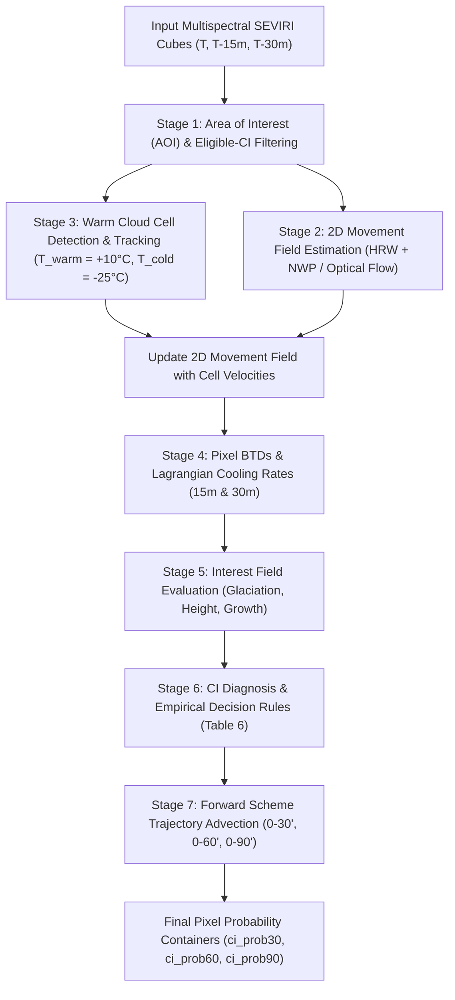

# EUMETSAT NWC SAF Convection Initiation (GEO-CI) Algorithm Specification

This document provides the exhaustive mathematical, physical, and algorithmic specification of the **EUMETSAT NWC SAF Convection Initiation (`GEO-CI`)** product (v2.0 / v2018 / v2025), derived from the authoritative documentation:

1. **ATBD v2.1**: *Algorithm Theoretical Basis Document for the Convection Product Processors of the NWC/GEO (`GEO-RDT-CW v5.0` and `GEO-CI v2.0`)*, Document Code `NWC/CDOP2/GEO/MFT/SCI/ATBD/Convection`, Issue 2.1, 21 January 2019, Météo-France / EUMETSAT NWC SAF.
2. **User Manual v1.0**: *User Manual for the Convection Product Processors of the NWC/GEO*, Document Code `NWC/CDOP3/GEO/MF-PI/SCI/UM/Convection`, Issue 1.0, 21 January 2019.
3. **GEO v2025 Specification**: *NWC SAF Convection Initiation (CI) v2025 Product Description & Updates* (Météo-France, 2025/2026).
4. **Best Practice Document (2013)**: *Convection Working Group (CWG) Best Practice Document for Nowcasting and Convection Initiation*, Eds. J. Mecikalski, K. Bedka, M. König (SATCAST methodology).

---

## 1. Product Overview & Meteorological Mission

### 1.1 Objective and Scope
The **Convection Initiation (CI)** product produces pixel-level probabilities for a developing cloudy pixel to transition into an active convective thunderstorm within three forward time horizons:
- **`0–30 min`** (`ci_prob30`)
- **`0–60 min`** (`ci_prob60`)
- **`0–90 min`** (`ci_prob90`)

The product focuses exclusively on the earliest trigger phases of deep moist convection:
- Identifying convective updraft signatures in nascent cumulus and cumulus congestus clouds.
- Operating on **warm and developing clouds** ($T_{\text{IR10.8}} \ge -25^\circ\text{C} = 248.15\text{ K}$).
- Ignoring already developed mature deep convection (which is tracked and diagnosed downstream by `GEO-RDT-CW`).

### 1.2 Output Probability Classes
Each pixel is categorized into four discrete probability intervals (with an optional unconditioned class):
- **Class 0 (`NO_PROB`)**: No probability of convective initiation ($0\%$).
- **Class 1 (`VLOWPROB`)**: Very low probability of initiation ($0\% < P \le 25\%$).
- **Class 2 (`LOWPROB`)**: Low probability of initiation ($25\% < P \le 50\%$).
- **Class 3 (`MODPROB`)**: Moderate probability of initiation ($50\% < P \le 75\%$).
- **Class 4 (`HIGHPROB`)**: High probability of initiation ($75\% < P \le 100\%$).

A meteorological monotonicity constraint is enforced across forecast horizons:
$$P_{30} \le P_{60} \le P_{90}$$
(The cumulative probability of thunderstorm initiation within 60 minutes cannot be lower than the probability within 30 minutes).

---

## 2. Terminology & Conceptual Framework

At any given satellite observation time $T$:
1. **Eligible-CI Pixel**: A pixel passing the initial environmental and thermal filters (is cloudy, located in an unstable/convective airmass, and has warm cloud-top temperature $T_{\text{IR10.8}} \ge -25^\circ\text{C}$). Cold cloud shields and mature thunderstorms are excluded.
2. **Pre-CI Pixel**: An eligible-CI pixel passing secondary static BTD/BT physical criteria (demonstrating early signs of vertical extension, cloud-top cooling, or glaciation).
3. **Diagnosed CI Pixel**: A pre-CI pixel whose multi-criteria interest field combination satisfies the empirical decision rules for convective initiation, assigned a probability class for each lead time horizon ($30'$, $60'$, $90'$).
4. **Spread CI Pixel (Forward Scheme)**: A pixel traversed by the cloud element during forward advection along the 2D movement trajectory over the forecast lead time.

---

## 3. The 7 Processing Stages of the Algorithm

---

### Stage 1: Area of Interest (AOI) & Eligible-CI Pixel Identification

To optimize computational efficiency and eliminate false alarms from non-convective environments, the candidate pixel domain is filtered:

1. **Cloud Mask Filtering**: Non-cloudy pixels are discarded. In the pure SEVIRI implementation, a thermal cloud mask is computed from split-window difference ($T_{\text{IR10.8}} - T_{\text{IR12.0}}$) and water vapor channel brightness temperatures.
2. **Warm Cloud Temperature Cap**:
   $$T_{\text{IR10.8}} \ge T_{\text{cold, CI}} = -25.0^\circ\text{C} \quad (248.15\text{ K})$$
   Pixels colder than $-25^\circ\text{C}$ have already glaciated and reached mid-to-high tropospheric levels; they belong to the mature storm domain of RDT-CW.
3. **Atmospheric Instability Filter (NWP Convective Mask, optional)**:
   When NWP data or reanalysis is available:
   - Lifted Index: Convective if $LI \le -3.0$, Stable if $LI \ge 0.0$.
   - Showalter Index: Convective if $SHW \le -3.0$, Stable if $SHW \ge 3.0$.
   - K-Index: Convective if $KI \ge 30.0$, Stable if $KI \le 20.0$.
   $$M_{\text{NWP}} = \begin{cases} 
   0 & \text{if } LI > 0 \text{ and } SHW > 3 \text{ and } KI < 20 \quad (\text{Fully Stable: Excluded}) \\
   2 & \text{if } LI \le -3 \text{ or } SHW \le -3 \text{ or } KI \ge 30 \quad (\text{Unstable: Priority}) \\
   1 & \text{otherwise (Unclear / Neutral)}
   \end{cases}$$
   In the Pure-SEVIRI IR configuration without external NWP, $M_{\text{NWP}} = 1$ everywhere over cloud.

---

### Stage 2: 2D Movement Field Estimation

Convection initiation requires computing **Lagrangian cooling rates** following the cloud parcel motion. A continuous 2D horizontal motion field $\vec{V}(x, y) = (u, v)$ is required:
1. **First-Guess Field**: Initialized from low-level wind (850 hPa flow) or Atmospheric Motion Vectors (AMVs) derived from high-resolution water vapor/infrared cross-correlation.
2. **Object Updating**: Whenever a warm cloud cell is successfully tracked between slot $T-1$ and slot $T$ with velocity $\vec{V}_{\text{cell}} = (\Delta x / \Delta t, \Delta y / \Delta t)$, all pixels inside the cell footprint inherit $\vec{V}_{\text{cell}}$.
3. **Spatial Blending**: A Gaussian distance-weighted smoothing filter propagates cloud motion into surrounding regions with radius $R \approx 24\text{ pixels}$.

---

### Stage 3: Warm Cloud Cell Detection & Tracking (Object Analysis)

An adaptive multi-thresholding morphological segmentation is applied to the infrared $10.8\,\mu\text{m}$ image, tailored specifically to warm cloud cells:
- **Warmest Threshold**: $T_{\text{warm}} = +10.0^\circ\text{C} = 283.15\text{ K}$
- **Coldest Threshold**: $T_{\text{cold}} = -25.0^\circ\text{C} = 248.15\text{ K}$
- **Temperature Step**: $\Delta T = 1.0\text{ K}$ (35 slicing levels)
- **Minimum Budding Extension / Prominence**: $\Delta T_{\text{tour}} = 3.0\text{ K}$ (lower than RDT's $6.0\text{ K}$ to detect shallow developing cumuli)
- **Area Range**: $S_{\min} = 1\text{ km}^2$ (or $60\text{ km}^2$ depending on grid scale), $S_{\max} = 10,000\text{ km}^2$.

Connected components at each slicing level identify local brightness temperature minima. When cells are tracked across consecutive slots via spatial overlap and velocity advection:
$$\text{AOR}(C_t, C_{t-1}) = \frac{\text{Area}(C_t \cap \mathcal{T}_{\vec{V}\Delta t}(C_{t-1}))}{\min(\text{Area}(C_t), \text{Area}(C_{t-1}))} \ge 0.15$$
their Lagrangian trajectory is registered and used to refine the 2D movement field.

---

### Stage 4: Pixel-Level BTDs & Lagrangian Cooling Rates

For every eligible-CI pixel at coordinates $\vec{x} = (x, y)$ at time $T$:

#### 4.1 Static Spectral Differences (BTDs)
1. **$\text{WBTD}$ (Water Vapor BTD)**:
   $$\text{WBTD} = T_{\text{WV6.2}} - T_{\text{WV7.3}}$$
2. **$\text{BTD}$ (Cloud-Top Height vs. Upper Troposphere)**:
   $$\text{BTD} = T_{\text{WV6.2}} - T_{\text{IR10.8}}$$
3. **$\text{BTD}_4$ (Glaciation / Phase Difference)**:
   $$\text{BTD}_4 = T_{\text{IR10.8}} - T_{\text{IR8.7}}$$
4. **$\text{BTD}_5$ (Optical Thickness / Split-Window)**:
   $$\text{BTD}_5 = T_{\text{IR12.0}} - T_{\text{IR10.8}}$$
5. **$\text{BTD}_6$ ($\text{CO}_2$ Slicing / Cloud Height)**:
   $$\text{BTD}_6 = T_{\text{IR13.4}} - T_{\text{IR10.8}}$$

#### 4.2 Dynamic Lagrangian Trends
Using the 2D movement vector $\vec{V}(\vec{x})$, the past parcel position at $T - \Delta t$ is estimated via backward advection:
$$\vec{x}_{\text{prev}} = \vec{x} - \vec{V}(\vec{x}) \cdot \Delta t$$
Bilinear interpolation samples the corresponding past satellite values:
1. **$\text{TxBT}_{15\text{m}}$ (15-min Cloud-Top Cooling Rate)**:
   $$\text{TxBT}_{15\text{m}} = \frac{T_{\text{IR10.8}}(T, \vec{x}) - T_{\text{IR10.8}}(T - 15\text{m}, \vec{x} - 15\vec{V})}{15\text{ min}}$$
2. **$\text{TxBT}_{30\text{m}}$ (30-min Cloud-Top Cooling Rate)**:
   $$\text{TxBT}_{30\text{m}} = \frac{T_{\text{IR10.8}}(T, \vec{x}) - T_{\text{IR10.8}}(T - 30\text{m}, \vec{x} - 30\vec{V})}{30\text{ min}} \times 15\text{ min}$$
3. **$\text{TxBTD}_{15\text{m}}$ (Updraft Growth Rate)**:
   $$\text{TxBTD}_{15\text{m}} = \text{BTD}(T, \vec{x}) - \text{BTD}(T - 15\text{m}, \vec{x}_{\text{prev}, 15})$$
4. **$\text{TxBTD}_{4, 15\text{m}}$ (Glaciation Rate)**:
   $$\text{TxBTD}_{4, 15\text{m}} = \text{BTD}_4(T, \vec{x}) - \text{BTD}_4(T - 15\text{m}, \vec{x}_{\text{prev}, 15})$$
5. **$\text{TxBTD}_{5, 15\text{m}}$ (Thinning/Growth Rate)**:
   $$\text{TxBTD}_{5, 15\text{m}} = \text{BTD}_5(T, \vec{x}) - \text{BTD}_5(T - 15\text{m}, \vec{x}_{\text{prev}, 15})$$
6. **$\text{TxBTD}_{6, 15\text{m}}$ (Vertical Growth Rate)**:
   $$\text{TxBTD}_{6, 15\text{m}} = \text{BTD}_6(T, \vec{x}) - \text{BTD}_6(T - 15\text{m}, \vec{x}_{\text{prev}, 15})$$

---

### Stage 5: Interest Field Evaluation & Physical Thresholds

Parameters are grouped into **three physical families**:

#### Family 1: Cloud-Top Glaciation (3 Parameters)
- $P_{\text{glac}, 1}$: $T_{\text{IR10.8}} \in [-25.0^\circ\text{C}, -20.0^\circ\text{C}]$ (or $> -25^\circ\text{C}$ in supercooled transition).
- $P_{\text{glac}, 2}$: Freezing transition $T_{\text{FZG}} \le 30\text{ min}$ (cloud top crossed $0^\circ\text{C} = 273.15\text{ K}$ within the last 30 minutes).
- $P_{\text{glac}, 3}$: Tri-spectral difference $\text{BTD}_4 = T_{\text{IR10.8}} - T_{\text{IR8.7}}$:
  - *Daytime (with CMIC)*: $\text{BTD}_4 \in [-10.0^\circ\text{C}, 0.0^\circ\text{C}]$
  - *Nighttime / Pure-IR (without CMIC)*: $\text{BTD}_4 \in [-2.1^\circ\text{C}, 0.0^\circ\text{C}]$

#### Family 2: Cloud Depth & Vertical Extension (Height) (4 Parameters)
- $P_{\text{height}, 1}$: $\text{BTD} = T_{\text{WV6.2}} - T_{\text{IR10.8}}$:
  - *Daytime*: $\text{BTD} \in [-35.0^\circ\text{C}, -10.0^\circ\text{C}]$
  - *Nighttime / Pure-IR*: $\text{BTD} \in [-34.0^\circ\text{C}, -12.0^\circ\text{C}]$
- $P_{\text{height}, 2}$: $\text{BTD}_5 = T_{\text{IR12.0}} - T_{\text{IR10.8}}$:
  - *Daytime*: $\text{BTD}_5 \in [-3.0^\circ\text{C}, 0.0^\circ\text{C}]$
  - *Nighttime / Pure-IR*: $\text{BTD}_5 \in [-2.2^\circ\text{C}, 0.0^\circ\text{C}]$
- $P_{\text{height}, 3}$: $\text{BTD}_6 = T_{\text{IR13.4}} - T_{\text{IR10.8}}$:
  - *Daytime*: $\text{BTD}_6 \in [-25.0^\circ\text{C}, -5.0^\circ\text{C}]$
  - *Nighttime / Pure-IR*: $\text{BTD}_6 \in [-17.0^\circ\text{C}, -6.0^\circ\text{C}]$
- $P_{\text{height}, 4}$: $\text{WBTD} = T_{\text{WV6.2}} - T_{\text{WV7.3}}$:
  - *Daytime*: $\text{WBTD} \in [-25.0^\circ\text{C}, -3.0^\circ\text{C}]$
  - *Nighttime / Pure-IR*: $\text{WBTD} \in [-17.0^\circ\text{C}, -7.0^\circ\text{C}]$

#### Family 3: Cloud Growth & Updraft Intensity (3 Indicators)
- $P_{\text{growth}, 1}$: Strong IR10.8 cooling:
  $$\text{TxBT}_{15\text{m}} \in [-50.0^\circ\text{C}/15\text{m}, -4.0^\circ\text{C}/15\text{m}] \quad (\text{cooling rate } \ge 4.0\text{ K}/15\text{m})$$
- $P_{\text{growth}, 2}$: Vertical vapor displacement:
  $$\text{TxBTD}_{15\text{m}} > +3.0^\circ\text{C}/15\text{m} \quad \text{or} \quad \text{TxBTD}_{6, 15\text{m}} > +3.0^\circ\text{C}/15\text{m}$$
- $P_{\text{growth}, 3}$: Rapid microphysical optical thickening:
  $$\text{TxBTD}_{4, 15\text{m}} \in [0.0^\circ\text{C}/15\text{m}, 10.0^\circ\text{C}/15\text{m}] \quad \text{or} \quad \text{TxBTD}_{5, 15\text{m}} \in [0.0^\circ\text{C}/15\text{m}, 10.0^\circ\text{C}/15\text{m}]$$

For each pixel, the number of satisfied criteria in each family is tallied:
$$N_{\text{growth}} \in \{0, 1, 2, 3\}, \quad N_{\text{glaciation}} \in \{0, 1, 2, 3\}, \quad N_{\text{height}} \in \{0, 1, 2, 3, 4\}$$

---

### Stage 6: Empirical CI Diagnosis (Table 6 Decision Tree)

The final probability class $C \in \{0, 1, 2, 3, 4\}$ is evaluated from $(N_{\text{growth}}, N_{\text{glaciation}}, N_{\text{height}})$ using the official Table 6 hierarchy:

| $N_{\text{growth}}$ (out of 3) | $N_{\text{glaciation}}$ (out of 3) | $N_{\text{height}}$ (out of 4) | Diagnosed Class | Probability Range |
| :---: | :---: | :---: | :---: | :---: |
| $\ge 2$ | $\ge 3$ | $\ge 4$ | **Class 4 (`HIGHPROB`)** | $75\% – 100\%$ |
| $\ge 2$ | $\ge 3$ | $= 3$ | **Class 3 (`MODPROB`)** | $50\% – 75\%$ |
| $\ge 2$ | $\ge 3$ | $< 3$ | **Class 2 (`LOWPROB`)** | $25\% – 50\%$ |
| $\ge 2$ | $= 2$ | $\ge 4$ | **Class 3 (`MODPROB`)** | $50\% – 75\%$ |
| $\ge 2$ | $= 2$ | $= 3$ | **Class 2 (`LOWPROB`)** | $25\% – 50\%$ |
| $\ge 2$ | $= 2$ | $< 3$ | **Class 1 (`VLOWPROB`)** | $0\% – 25\%$ |
| $\ge 1$ | $\ge 3$ | $\ge 4$ | **Class 3 (`MODPROB`)** | $50\% – 75\%$ |
| $\ge 1$ | $\ge 3$ | $< 4$ | **Class 2 (`LOWPROB`)** | $25\% – 50\%$ |
| $\ge 1$ | $= 2$ | $\ge 4$ | **Class 2 (`LOWPROB`)** | $25\% – 50\%$ |
| $\ge 1$ | $= 2$ | $= 3$ | **Class 1 (`VLOWPROB`)** | $0\% – 25\%$ |
| $= 0$ | $\ge 3$ | $\ge 3$ | **Class 2 (`LOWPROB`)** | $25\% – 50\%$ |
| $= 0$ | $\ge 3$ | $< 3$ | **Class 1 (`VLOWPROB`)** | $0\% – 25\%$ |
| **All other combinations** | — | — | **Class 0 (`NO_PROB`)** | $0\%$ |

---

### Stage 7: Forward Scheme (Lagrangian Extrapolation)

A diagnosed CI pixel at position $\vec{x}$ with velocity $\vec{V}$ is expected to advect downstream as convection initiates:
1. For lead time $\Delta t = 30\text{ min}$, the cloud path covers the segment:
   $$\mathcal{L}_{30} = \{\vec{x} + \alpha \cdot \vec{V} \cdot 30\text{ min} \mid \alpha \in [0, 1]\}$$
2. For lead time $\Delta t = 60\text{ min}$:
   $$\mathcal{L}_{60} = \{\vec{x} + \alpha \cdot \vec{V} \cdot 60\text{ min} \mid \alpha \in [0, 1]\}$$
3. For lead time $\Delta t = 90\text{ min}$:
   $$\mathcal{L}_{90} = \{\vec{x} + \alpha \cdot \vec{V} \cdot 90\text{ min} \mid \alpha \in [0, 1]\}$$

All pixels intersected by the dilated path footprint inherit the maximum probability class diagnosed along that trajectory.

Finally, the monotonicity rule is enforced pixel-wise:
$$C_{\text{final}, 30} = C_{30}, \quad C_{\text{final}, 60} = \max(C_{60}, C_{\text{final}, 30}), \quad C_{\text{final}, 90} = \max(C_{90}, C_{\text{final}, 60})$$

---

## 4. Summary Table of Interest Field Thresholds

| Parameter Name | Channel Formula | Meaning | Day Threshold (with CMIC) | Night / Pure-IR Threshold |
| :--- | :--- | :--- | :--- | :--- |
| **$T_{\text{IR10.8}}$** | $\text{IR}_{10.8}$ | Glaciation cap / AOI | $> -25.0^\circ\text{C}$ ($> -20.0^\circ\text{C}$) | $> -25.0^\circ\text{C}$ ($> -20.0^\circ\text{C}$) |
| **$T_{\text{FZG}}$** | $t - t_{0^\circ\text{C}}$ | Freezing transition | $\le 30\text{ min}$ | $\le 30\text{ min}$ |
| **$\text{BTD}_4$** | $\text{IR}_{10.8} - \text{IR}_{8.7}$ | Glaciation index | $]-10.0^\circ\text{C}, 0.0^\circ\text{C}[$ | $]-2.1^\circ\text{C}, 0.0^\circ\text{C}[$ |
| **$\text{BTD}$** | $\text{WV}_{6.2} - \text{IR}_{10.8}$ | Cloud top vs. UTLS height | $]-35.0^\circ\text{C}, -10.0^\circ\text{C}[$ | $]-34.0^\circ\text{C}, -12.0^\circ\text{C}[$ |
| **$\text{BTD}_5$** | $\text{IR}_{12.0} - \text{IR}_{10.8}$ | Optical depth / Split-window | $]-3.0^\circ\text{C}, 0.0^\circ\text{C}[$ | $]-2.2^\circ\text{C}, 0.0^\circ\text{C}[$ |
| **$\text{BTD}_6$** | $\text{IR}_{13.4} - \text{IR}_{10.8}$ | $\text{CO}_2$ vertical depth | $]-25.0^\circ\text{C}, -5.0^\circ\text{C}[$ | $]-17.0^\circ\text{C}, -6.0^\circ\text{C}[$ |
| **$\text{WBTD}$** | $\text{WV}_{6.2} - \text{WV}_{7.3}$ | Water vapor stratification | $]-25.0^\circ\text{C}, -3.0^\circ\text{C}[$ | $]-17.0^\circ\text{C}, -7.0^\circ\text{C}[$ |
| **$\text{TxBT}_{15\text{m}}$** | $\Delta T_{\text{IR10.8}} / 15\text{m}$ | Cloud-top cooling rate | $]-50.0^\circ\text{C}, -4.0^\circ\text{C}[/15\text{m}$ | $]-50.0^\circ\text{C}, -4.0^\circ\text{C}[/15\text{m}$ |
| **$\text{TxBTD}_{15\text{m}}$** | $\Delta \text{BTD} / 15\text{m}$ | Vertical height growth | $> +3.0^\circ\text{C}/15\text{m}$ | $> +3.0^\circ\text{C}/15\text{m}$ |
| **$\text{TxBTD}_{4, 15\text{m}}$** | $\Delta \text{BTD}_4 / 15\text{m}$ | Glaciation growth trend | $]0.0^\circ\text{C}, 10.0^\circ\text{C}[/15\text{m}$ | $]0.0^\circ\text{C}, 10.0^\circ\text{C}[/15\text{m}$ |
| **$\text{TxBTD}_{5, 15\text{m}}$** | $\Delta \text{BTD}_5 / 15\text{m}$ | Optical depth growth trend | $]0.0^\circ\text{C}, 10.0^\circ\text{C}[/15\text{m}$ | $]0.0^\circ\text{C}, 10.0^\circ\text{C}[/15\text{m}$ |
| **$\text{TxBTD}_{6, 15\text{m}}$** | $\Delta \text{BTD}_6 / 15\text{m}$ | Deepening growth trend | $> +3.0^\circ\text{C}/15\text{m}$ | $> +3.0^\circ\text{C}/15\text{m}$ |
