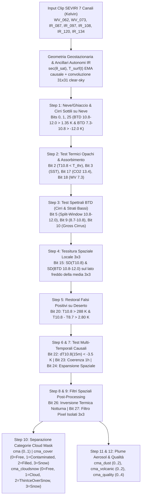

# Algoritmo NWC SAF Cloud Mask (`GEO-CMA v6.0` / `v2025`, NWC-004) in Modalità Pura 7 Canali IR SEVIRI

Questo documento descrive in dettaglio l'architettura fisica, matematica e algoritmica del detector **Cloud Mask (`GEO-CMA v6.0`, `v2025`)** implementato nel pacchetto autonomo [`CMA_original/cma_nwcsaf/`](file:///c:/Users/Daniele.LOKI/Documents/Progetti/deep_convection/CMA_original/cma_nwcsaf/__init__.py) a partire dalle specifiche ufficiali EUMETSAT NWC SAF (*NWC/CDOP2/GEO/MFL/SCI/ATBD/Cloud, Issue 1, Rev. 1* e *NWC/CDOP3/GEO/MFL/SCI/ATBD/Cloud v2025*).

---

## 1. Perché il Cloud Mask NWC SAF è un Detector a 3 Classi Positive (+ 1 Classe Negativa)

Nell'ecosistema EUMETSAT NWC SAF (`GEO-CMA`), oltre alla maschera binaria semplificata (`cma`: `0 = Cloud-free`, `1 = Cloudy`), il prodotto Cloud Mask definisce **due rappresentazioni a 4 livelli** costituite da **1 classe negativa (`0 = Cloud-free`)** e **3 classi positive**:

### A. Categorie di Copertura Nuvolosa (`cma_cover` — ATBD Sezione 2.2.1.2.2, p. 13 e MPEF/NWC SAF classico)
È la classificazione fisica della frazione/opacità di copertura del pixel:
- **`0 = CLOUD_FREE` (Classe Negativa):** Pixel libero da nubi e libero da neve/ghiaccio.
- **`1 = CLOUD_CONTAMINATED` (Classe Positiva 1 — Parzialmente nuvoloso / Sub-pixel / Semitrasparente):** Pixel contaminato da nubi sub-pixel, bordi nuvolosi eterogenei, cirri sottili semitrasparenti in cristalli di ghiaccio, nubi sottili sopra neve/ghiaccio, o nubi incipienti intercettate dai test di tessitura spaziale ($3\times 3$) o di raffreddamento temporale rapido ($15\text{ min}$) o prossime alla soglia radiometrica (entro il margine di sicurezza).
- **`2 = CLOUD_FILLED` (Classe Positiva 2 — Pienamente coperto da nube opaca):** Pixel completamente riempito da un corpo nuvoloso opaco che supera nettamente il margine di sicurezza radiometrico nei test termici/assorbimento ($\text{IR}_{10.8}$, $\text{SST}$, $\text{CO}_2\ 13.4\,\mu\text{m}$, $\text{WV}\ 7.3\,\mu\text{m}$, o strato basso opaco $\text{IR}_{8.7}-\text{IR}_{10.8}$) ed è circondato da un intorno $3\times 3$ prevalentemente nuvoloso ($\ge 5/9$ pixel).
- **`3 = SNOW_OR_ICE` (Classe Positiva 3 — Contaminato da Neve o Ghiaccio marino):** Pixel privo di nubi ma coperto da neve continentale su terra o ghiaccio marino su mare.

### B. Contenitore Cloud & Snow v2025 (`cma_cloudsnow` — ATBD Sezione 2.2.2.4, Tabella 4, p. 59)
È il contenitore ufficiale introdotto per gli utenti neve/criosfera in `GEO-CMA v2025`:
- **`0 = CLOUD_FREE` (Classe Negativa):** Cielo sereno su superficie libera da neve/ghiaccio.
- **`1 = CLOUD` (Classe Positiva 1):** Nube (tutte le nubi opache, semitrasparenti o sub-pixel, ad eccezione dei cirri sottili sopra neve/ghiaccio).
- **`2 = THIN_ICE_CLOUD_OVER_SNOW` (Classe Positiva 2):** Nube sottile di ghiaccio sovrapposta a superficie innevata o ghiacciata ($\text{BTD}_{10.8-12.0} > 1.35\text{ K}$ e $\text{BTD}_{7.3-10.8} > -12.0\text{ K}$ su mappa neve/ghiaccio attiva).
- **`3 = SNOW_OR_ICE` (Classe Positiva 3):** Neve continentale o ghiaccio marino in cielo sereno.

Il modulo [`CMA_original/cma_nwcsaf/detector.py`](file:///c:/Users/Daniele.LOKI/Documents/Progetti/deep_convection/CMA_original/cma_nwcsaf/detector.py) produce simultaneamente **entrambe** le maschere a 4 classi (`cma_cover` e `cma_cloudsnow`), la maschera binaria (`cma`), i 3 detector di aerosol (`cma_dust`, `cma_volcanic`, `cma_smoke`), la bitmask diagnostica a 28 bit (`cma_testlist`), i flag di stato a 11 bit (`cma_status_flag`) e il livello di qualità (`cma_quality`).

---

## 2. Invarianti dei Dati di Ingresso (7 Canali IR SEVIRI)

L'algoritmo opera in **modalità pura infrarossa H24** (senza dipendere dai canali solari $\text{VIS}_{0.6}$, $\text{VIS}_{0.8}$, $\text{NIR}_{1.6}$ né dal canale misto solare/termico $\text{IR}_{3.9}$) utilizzando esclusivamente i 7 canali termici e di assorbimento SEVIRI in temperatura di brillanza (Kelvin):

| Indice | Canale | $\lambda_c$ ($\mu\text{m}$) | Ruolo fisico principale in `GEO-CMA` |
| :---: | :--- | :---: | :--- |
| `0` | `WV_062` | $6.25$ | Vapore acqueo alta troposfera: stima della temperatura di tropopausa ($T_{\text{tropo}}$) e verifica colonne serene |
| `1` | `WV_073` | $7.35$ | Vapore acqueo media troposfera: test nubi medio-alte (`Bit 18`), cirri su neve (`Bit 1`) e filtro inversione termica (`Bit 26`) |
| `2` | `IR_087` | $8.70$ | Finestra microfisica/emissività: test cirri di ghiaccio e strati bassi (`Bit 9`), restoral desertico (`Bit 20`), polvere (`cma_dust`) e cenere vulcanica (`cma_volcanic`) |
| `3` | `IR_097` | $9.66$ | Assorbimento ozono/alta troposfera: discriminazione colonne serene per la stima autonoma di $T_{\text{surf}}$ |
| `4` | `IR_108` | $10.80$ | Finestra atmosferica pulita: test termico primario (`Bit 2`), tessitura spaziale $3\times 3$ (`Bit 15`), raffreddamento a $15\text{ min}$ (`Bit 22`) e coerenza a $1\text{ h}$ (`Bits 23–24`) |
| `5` | `IR_120` | $12.00$ | Finestra sporca ($\text{H}_2\text{O}$ continuo): split-window $\text{IR}_{10.8}-\text{IR}_{12.0}$ per cirri semitrasparenti (`Bits 5, 10`), correzione $\text{SST}$ (`Bit 3`) e inversione spettrale di dust/ash |
| `6` | `IR_134` | $13.40$ | Banda $\text{CO}_2$ troposferica: test di quota nube opaca medio-alta (`Bit 17`) e screening colonne serene |

---

## 3. Flusso Decisionale Completo (`GEO-CMA v6.0`)

---

## 4. Formulazione Matematica degli Stadi dell'Algoritmo

### 4.1 Geometria di Osservazione e Stima Autonoma Causale di $T_{\text{surf}}$ (`ancillary.py`)
Per ogni pixel di coordinate $(\phi, \lambda)$ osservato dal satellite geostazionario a longitudine sub-satellitare $\lambda_0$, la secante dell'angolo zenitale satellitare $\sec\theta_{\text{sat}} = 1/\cos\theta_{\text{sat}}$ modula lo spessore ottico lungo la linea di vista.

In assenza di campi NWP esterni, [`estimate_autonomous_ir_ancillary`](file:///c:/Users/Daniele.LOKI/Documents/Progetti/deep_convection/CMA_original/cma_nwcsaf/ancillary.py#L76-L249) stima la temperatura di pelle in cielo sereno $T_{\text{surf}}(t)$:
1. Calcola la temperatura superficiale istantanea corretta per il continuo del vapore acqueo:
   $$T_{\text{skin,inst}} = \text{IR}_{10.8} + 0.85 \cdot \max(0, \text{IR}_{10.8} - \text{IR}_{12.0}) \cdot \min(\sec\theta_{\text{sat}}, 2.2)$$
2. Identifica le colonne atmosferiche sicuramente serene tramite il voto concorde ($\ge 3$ su $4$) dei canali di assorbimento troposferico rispetto alla finestra $\text{IR}_{10.8}$:
   $$\text{IR}_{10.8} - \text{WV}_{6.2} > 22\text{ K}, \quad \text{IR}_{10.8} - \text{WV}_{7.3} > 11\text{ K}, \quad \text{IR}_{10.8} - \text{IR}_{13.4} > 13\text{ K}, \quad \text{IR}_{10.8} - \text{IR}_{9.7} > 12\text{ K}$$
   combinato con $\text{IR}_{10.8} > 262\text{ K}$, $\text{IR}_{10.8} - \text{IR}_{12.0} < 1.75\text{ K}$ e $\text{IR}_{8.7} - \text{IR}_{10.8} < 0.35\text{ K}$.
3. Calcola la media spaziale locale in cielo sereno su finestre di segmento $31\times 31$ pixel ($\sim 90\text{ km}$, con fallback a $91\times 91$ in caso di copertura estesa) e aggiorna causalmente nel tempo tramite media mobile esponenziale ($\alpha = 0.25$).

---

### 4.2 Test Radiometrici Primari, Spettrali e Spaziali (`detector.py`)

1. **Test Termico $\text{IR}_{10.8}$ (`Bit 2`) e $\text{SST}$ (`Bit 3`):**
   $$T_{10.8,\text{thr}} = \max\!\Big(T_{\text{surf}} - \big[\Delta T_{\text{base}} + 3.5\,(\sec\theta_{\text{sat}} - 1) + \Delta T_{\text{coast}}\big],\; 258.0\text{ K}\Big)$$
   con $\Delta T_{\text{base}} = 8.0\text{ K}$ su terra e $4.5\text{ K}$ su mare. Su mare aperto viene inoltre applicato il test di stima $\text{SST}$ split-window:
   $$\text{SST}_{\text{est}} = \text{IR}_{10.8} + 1.15\,\max(0, \text{IR}_{10.8} - \text{IR}_{12.0}) < T_{\text{surf}} - \big[3.5 + 1.5\,(\sec\theta_{\text{sat}} - 1)\big]$$

2. **Test di Assorbimento $\text{CO}_2\ 13.4\,\mu\text{m}$ (`Bit 17`) e $\text{H}_2\text{O}\ 7.3\,\mu\text{m}$ (`Bit 18`):**
   - `Bit 17`: $\text{IR}_{10.8} < 263.0\text{ K} \;\land\; (\text{IR}_{10.8} - \text{IR}_{13.4}) < 12.0\text{ K}$
   - `Bit 18`: $\text{IR}_{10.8} < 268.0\text{ K} \;\land\; (\text{WV}_{7.3} - \text{IR}_{10.8}) > -8.5\text{ K}$ (escludendo i pixel identificati come inversione termica al suolo).

3. **Test Cirri Semitrasparenti e Strati Bassi (`Bits 5, 9, 10`):**
   - **Split-window (`Bit 5`):**
     $$\text{IR}_{10.8} - \text{IR}_{12.0} > \Delta T_{\text{sw,base}} + 0.55\,(\sec\theta_{\text{sat}} - 1) + 0.045\,\max(0, \text{IR}_{10.8} - 270\text{ K})$$
     con $\Delta T_{\text{sw,base}} = 1.35\text{ K}$ (mare) e $1.75\text{ K}$ (terra).
   - **Test $\text{IR}_{8.7} - \text{IR}_{10.8}$ (`Bit 9`):** cattura sia i cirri in ghiaccio ($\text{IR}_{8.7} - \text{IR}_{10.8} > +0.35\text{ K}$ con $\text{IR}_{10.8} < 278\text{ K}$) sia i banchi di strati bassi/nebbia in goccioline d'acqua ($\text{IR}_{8.7} - \text{IR}_{10.8} < -2.10\text{ K}$ su mare o $<-3.20\text{ K}$ su terra, con split-window ridotto).
   - **Test Combinato Gross Cirrus (`Bit 10`):**
     $$(\text{IR}_{10.8} - \text{IR}_{12.0}) + \max(0, \text{IR}_{8.7} - \text{IR}_{10.8}) > 1.90\text{ K}$$

4. **Test di Tessitura Spaziale Locale $3\times 3$ (`Bit 15`):**
   Calcola la deviazione standard locale $\sigma_{3\times 3}(\text{IR}_{10.8})$ e $\sigma_{3\times 3}(\text{IR}_{10.8}-\text{IR}_{12.0})$ esclusivamente tra pixel appartenenti allo stesso tipo di superficie (terra o mare), attivandosi sui pixel più freddi della media $3\times 3$ locale ($\text{IR}_{10.8} < \overline{\text{IR}}_{10.8,3\times 3} - 0.15\text{ K}$) quando $\sigma_{3\times 3}(\text{IR}_{10.8}) > 0.85\text{ K}$ (mare) o $> 2.50\text{ K}$ (terra).

5. **Restoral e Test Multi-Temporali (`Bits 20, 22, 23, 24, 26, 27`):**
   - **Restoral Desertico (`Bit 20`):** ripristina a cielo sereno i pixel caldi su terra ($\text{IR}_{10.8} > 288\text{ K}$) con forte deficit di emissività del quarzo a $8.7\,\mu\text{m}$ ($\text{IR}_{10.8} - \text{IR}_{8.7} > 2.80\text{ K}$) privi di firma $\text{CO}_2/\text{WV}$.
   - **Raffreddamento Temporale a 15 Minuti (`Bit 22`):** intercetta i cumuli in rapido sviluppo quando $\text{IR}_{10.8}(t) - \text{IR}_{10.8}(t - 15\text{ min}) < -3.5\text{ K}$.
   - **Coerenza Stazionaria a 1 Ora (`Bit 23`) ed Espansione Spaziale (`Bit 24`):** rimuove le anomalie fredde del suolo immobili da 60 minuti ($|\Delta\text{IR}_{10.8}(60\text{ min})| < 0.35\text{ K}$ e $\sigma_{3\times 3} < 0.50\text{ K}$) ed espande per region-growing i bordi nuvolosi adiacenti a nuclei freddi che si sono raffreddati di oltre $1.5\text{ K}$ nell'ultima ora.
   - **Filtro Spaziale Inversione Termica (`Bit 26`) e Filtro Pixel Isolati (`Bit 27`):** ripristina a sereno le inversioni termiche notturne omogenee su terra e rimuove i singoli pixel rumorosi isolati ($\ge 7/8$ vicini discordi in finestra $3\times 3$).

---

### 4.3 Regola di Separazione tra `CLOUD_CONTAMINATED (1)` e `CLOUD_FILLED (2)` in `cma_cover`
In conformità con l'ATBD Sezione 2.2.1.2.2 (pp. 12–13, 30–31), ogni pixel classificato come nuvoloso (`cloudy == True`) viene ripartito tra le due classi nuvolose positive di `cma_cover`:

- È assegnato a **`CLOUD_FILLED (2)`** se e solo se soddisfa **tutte** le seguenti condizioni:
  1. Almeno un test radiometrico opaco primario supera il proprio margine di sicurezza:
     $$(T_{10.8,\text{thr}} - \text{IR}_{10.8} \ge 3.0\text{ K}) \;\lor\; (\text{SST}_{\text{thr}} - \text{SST}_{\text{est}} \ge 3.0\text{ K}) \;\lor\; \text{Bit 17 (CO}_2\text{)} \;\lor\; \text{Bit 18 (WV}_{7.3}\text{)} \;\lor\; \text{Strato basso opaco}$$
  2. Non è un cirro sottile semitrasparente ($\text{IR}_{10.8} - \text{IR}_{12.0} \le 2.40\text{ K}$, oppure ha temperatura profonda $\text{IR}_{10.8} < 242.0\text{ K}$) e non è un cirro sottile su neve (`~thin_ice_over_snow`).
  3. L'intorno locale $3\times 3$ contiene almeno $5$ pixel nuvolosi su $9$ (escludendo quindi i bordi nube sub-pixel).
- In tutti gli altri casi nuvolosi (bordi sub-pixel, cirri sottili semitrasparenti, nubi intercettate solo da tessitura $3\times 3$, raffreddamento a $15\text{ min}$, espansione spaziale o vicine alla soglia termica), il pixel è assegnato a **`CLOUD_CONTAMINATED (1)`**.

---

## 5. Benchmark su Dati SEVIRI Reali (Archivio 2020, 7 Canali)

Il benchmark [`CMA_original/scripts/benchmark_cma_on_seviri.py`](file:///c:/Users/Daniele.LOKI/Documents/Progetti/deep_convection/CMA_original/scripts/benchmark_cma_on_seviri.py) è stato eseguito su 4 sequenze reali da 16 frame ($64$ frame totali, $3{,}211{,}264$ pixel, cadenza $5\text{ min}$, dimensione $224\times 224$) estratte dall'archivio SEVIRI 2020:

| Clip ID | Timestamp Inizio (UTC) | `0: CLOUD_FREE` | `1: CLOUD_CONTAMINATED` | `2: CLOUD_FILLED` | `3: SNOW_OR_ICE` | Totale `CLOUDY` (`1 + 2`) | Tempo / Frame |
| :--- | :--- | :---: | :---: | :---: | :---: | :---: | :---: |
| `random_000` | `2020-05-31T15:00:00Z` | $41.39\%$ | $27.85\%$ | $30.76\%$ | $0.00\%$ | $58.61\%$ | $23.16\text{ ms}$ |
| `random_001` | `2020-08-23T00:25:00Z` | $74.48\%$ | $17.95\%$ | $7.57\%$ | $0.00\%$ | $25.52\%$ | $21.71\text{ ms}$ |
| `random_002` | `2020-05-29T22:40:00Z` | $85.72\%$ | $11.92\%$ | $2.37\%$ | $0.00\%$ | $14.28\%$ | $24.85\text{ ms}$ |
| `random_003` | `2020-09-17T13:20:00Z` | $47.31\%$ | $25.34\%$ | $27.35\%$ | $0.00\%$ | $52.69\%$ | $21.89\text{ ms}$ |
| ** Aggregato (64 frame)** | **3.21M pixel** | **$62.22\%$** | **$20.77\%$** | **$17.01\%$** | **$0.00\%$** | **$37.78\%$** | **$22.90\text{ ms}$** |

### Frequenza di Attivazione dei Bit Diagnostici (`cma_testlist`)
- `Bit 2` (`T108_BRIGHTNESS_TEMPERATURE`): **$24.10\%$** dei pixel totali
- `Bit 10` (`T108_T120_OR_T87_T108_GROSS`): **$19.20\%$**
- `Bit 17` (`T108_T134_TROPOSPHERIC_CO2`): **$12.84\%$**
- `Bit 5` (`T108_T120_SPLIT_WINDOW`): **$12.59\%$**
- `Bit 9` (`T87_T108`): **$11.61\%$**
- `Bit 22` (`TEMPORAL_DIFFERENCING_T108`): **$10.83\%$**
- `Bit 15` (`LOCAL_SPATIAL_TEXTURE`): **$8.89\%$**
- `Bit 18` (`T73_T108_WATER_VAPOUR`): **$8.10\%$**
- `Bit 27` (`ISOLATED_PIXEL_FILTER`): **$0.90\%$**
- `Bit 24` (`SPATIAL_CLOUD_EXPANSION`): **$0.032\%$**
- `Bit 23` (`TEMPORAL_COHERENCE_1H`): **$0.005\%$**
- `Bit 20` (`DESERT_T108_T87_RESTORAL`): **$0.003\%$**
