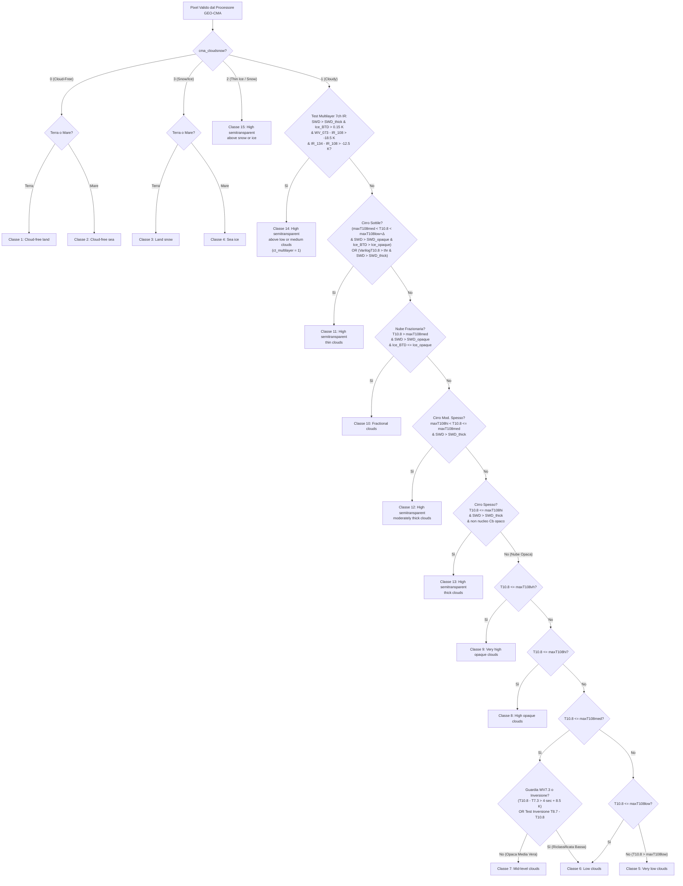

# Descrizione Teorica e Algoritmica del Processore NWC SAF Cloud Mask (`GEO-CMA`) e Cloud Type (`GEO-CT`) v2025 (`CT_original`)

> **Riferimenti Ufficiali EUMETSAT NWC SAF (Release v2025):**
> - **ATBD:** *Algorithm Theoretical Basis Document for the Cloud Product Processors of the NWC/GEO* (`NWC/CDOP2/MTG/MFL/SCI/ATBD/Cloud`, Issue 1.1.1, 30 Maggio 2025; `NWC/CDOP2/GEO/MFL/SCI/ATBD/Cloud`, Issue 1.1 / 2.1).
> - **User Manual (UM):** *User Manual for the Cloud Product Processors of the NWC/GEO: Science Part* (`NWC/CDOP3/MTG/MFL/SCI/UM/Cloud`, Issue 1.1.1, 30 Maggio 2025, applicabile a **`GEO-CMA-v6.0 (NWC-004)`** e **`GEO-CT-v5.0 (NWC-008)`**).
> - **Link di riferimento:** <https://www.nwcsaf.org/cma_v2025>

---

## 1. Obiettivo e Filosofia di Progettazione

Il pacchetto [`ct_nwcsaf`](file:///c:/Users/Daniele.LOKI/Documents/Progetti/deep_convection/CT_original/ct_nwcsaf/__init__.py) implementa l'intera catena operativa **Cloud Mask (`GEO-CMA v6.0`)** e **Cloud Type (`GEO-CT v5.0`)** di EUMETSAT NWC SAF (`v2025`), estendendo quanto già realizzato nel repository per **RDT (`RDT_original`)** e **CI (`CI_original`)**.

L'algoritmo è progettato per operare in **due modalità complementari**:
1. **Modalità Full NWP / Ancillary:** accetta in ingresso i campi verticali di temperatura e umidità da modello numerico (es. ERA5/ECMWF: $T_{\text{surf}}, T_{950}, T_{850}, T_{700}, T_{500}, T_{\text{tropo}}, \text{TCWV}$), maschere terra/mare/costa, mappe neve/ghiaccio marino e coordinate geografiche $(\text{lat}, \text{lon})$.
2. **Modalità Autonoma Pure-SEVIRI a 7 Canali Infrarossi (24/7 Diurna/Notturna):** opera esclusivamente sul tensore canonico a 7 canali termici/assorbimento di MSG/SEVIRI in temperatura di brillanza (Kelvin), con cadenza nominale di 5 minuti:
   $$\mathbf{X}_t \in \mathbb{R}^{7 \times H \times W}, \quad \text{canali} = \bigl[\text{WV}_{6.2},\;\text{WV}_{7.3},\;\text{IR}_{8.7},\;\text{IR}_{9.7},\;\text{IR}_{10.8},\;\text{IR}_{12.0},\;\text{IR}_{13.4}\bigr]$$
   garantendo invarianza diurna/notturna (assenza di discontinuità al terminatore solare dovute ai canali visibili o alla contaminazione solare a $3.8\,\mu\text{m}$) e piena compatibilità con il pretraining VideoMAE e con i prodotti convettivi `RDT` e `CI`.

---

## 2. Architettura del Flusso Algoritmico

```mermaid
flowchart TD
    A["Cubo SEVIRI 7 Canali in Kelvin<br/>(WV_062, WV_073, IR_087, IR_097, IR_108, IR_120, IR_134)"] --> B["Modulo 1: Geometria & Profilo Atmosferico<br/>(ancillary.py)"]
    NWP["Opzionale: Campi NWP / Maschere<br/>(T_surf, T_950..T_500, T_tropo, TCWV, Land/Snow)"] --> B

    B --> C["Geometria di Vista: sec(θ_sat)<br/>Trigonometria Sferica Geostazionaria (9.5°E)"]
    B --> D["Tracker Causale EMA di T_surf,ref<br/>& Sounding IR a 4 Bande (WV_062, WV_073, IR_097, IR_134)"]
    B --> E["Profilo Termico Verticale<br/>(T_950, T_850, T_700, T_500, T_tropo, TCWV)"]

    C & D & E --> F["Modulo 2: Processore GEO-CMA v6.0<br/>(cma.py)"]
    H15["Buffer Temporale t - 15 min<br/>(IR_108)"] --> F
    H60["Buffer Temporale t - 60 min<br/>(Cubo 7ch, CMA_1h, CT_1h, Qual_1h)"] --> F

    subgraph CMA_Sub ["Catena di Rilevamento GEO-CMA (Sezione 2 ATBD)"]
        F1["Test Spettrali Primari:<br/>• SST Split-Window (Mare)<br/>• T10.8 < T10.8_thr (con correzione Extreme Cooling)<br/>• Split-Window: T10.8 - T12.0 > SWD_thr<br/>• Fase Ghiaccio: T8.7 - T10.8 > Ice_thr<br/>• Nubi Basse Alto Angolo: T10.8 - T8.7 > 3.7 + 0.3·sec<br/>• Test Spettrale IR 7ch Nubi Basse/Medie (WV_073, IR_134)"]
        F2["Test Local Spatial Texture 3×3:<br/>SD(T10.8) & SD(BTD) omogenei per tipo di superficie"]
        F3["Test Temporale a 15 min (Bit 22):<br/>Δ_15min(T10.8) < -0.6 K (mare) / -1.8 K (terra)"]
        F4["Coerenza 1h & Region Growing 8-Connesso (Bit 23-24):<br/>Ripristino ed espansione nubi basse/medie stazionarie"]
        F5["Spatial Filtering Finale (Bit 26-27):<br/>• Inversione Notturna Fredda: T7.3 - T10.8 > 0.5 K<br/>• Filtro Costiero 3×3 / 7×7 & Bordo Neve<br/>• Rimozione Pixel Isolati 8-Connessi"]
        F6["Rilevamento Aerosol:<br/>• Polvere Sahariana (cma_dust)<br/>• Cenere Vulcanica (cma_volcanic)"]
        F1 --> F2 --> F3 --> F4 --> F5 --> F6
    end

    F --> G["Modulo 3: Processore GEO-CT v5.0 a 15 Classi<br/>(ct.py)"]

    subgraph CT_Sub ["Classificazione GEO-CT a 15 Classi (Sezione 3 ATBD)"]
        G1["Soglie Verticali Dinamiche NWC SAF:<br/>maxT108vh, maxT108hi, maxT108med, maxT108low,<br/>T108interthr, T108T73thrlow = 4.0·sec + 8.5 K"]
        G2["Classi Superficiali (1..4) e Cirri su Neve (15)"]
        G3["Separazione Nubi Semitrasparenti & Frazionarie:<br/>• Classe 14: Multilayer (Cirro su Nube Bassa/Media via WV_073 & IR_134)<br/>• Classe 11: Cirri Sottili (T10.8-T12.0 & T8.7-T10.8 & VarilogT10.8)<br/>• Classe 10: Nubi Frazionarie (SWD alto, T8.7-T10.8 basso)<br/>• Classe 12: Cirri Moderatamente Spessi<br/>• Classe 13: Cirri Spessi"]
        G4["Classificazione Verticale Nubi Opache (5..9):<br/>• Classe 9: Very High Opaque (T10.8 <= maxT108vh)<br/>• Classe 8: High Opaque<br/>• Classe 7: Mid-Level (con guardia T10.8 - T7.3 <= T108T73thrlow)<br/>• Classe 6: Low Clouds (include riclassificazione inversione T8.7-T10.8)<br/>• Classe 5: Very Low Clouds"]
        G5["Container Ausiliari & Bridge RDT/CI:<br/>• ct_cumuliform (Stratiforme/Cumuliforme/Misto)<br/>• ct_multilayer (0..3)<br/>• ct_quality (Margine di sicurezza 0.2 K)<br/>• rdt_bridge_class (6 classi compatibili RDT/CI)"]
        G1 --> G2 --> G3 --> G4 --> G5
    end
```

---

## 3. Ruolo Fisico dei 7 Canali SEVIRI nell'Algoritmo

Ogni canale del set canonico a 7 bande svolge un ruolo radiometrico specifico all'interno di `GEO-CMA` e `GEO-CT`:

| Indice | Canale | $\lambda_c$ ($\mu\text{m}$) | Ruolo Fisico in `GEO-CMA` e `GEO-CT` |
| :---: | :--- | :---: | :--- |
| **`0`** | `WV_062` | $6.25$ | **Vapore acqueo alta troposfera ($\sim 300\text{--}400\text{ hPa}$):** stima della temperatura di riferimento della tropopausa/UTLS ($T_{\text{tropo}}$), discriminazione tra nuclei convettivi opachi profondi ($\text{WV}_{6.2} - \text{IR}_{10.8} > -3.5\text{ K}$) e cirri semitrasparenti spessi (`Classe 13`), e voto di cielo sereno profondo ($\text{WV}_{6.2} - \text{IR}_{10.8} \le -18\text{ K}$). |
| **`1`** | `WV_073` | $7.35$ | **Vapore acqueo media/bassa troposfera ($\sim 500\text{--}600\text{ hPa}$):** guardia ufficiale NWC SAF `T10.8 - T7.3 > T108T73thrlow` per impedire che nubi basse vengano classificate come nubi medie (`Classe 7 -> Classe 6`), filtro spaziale di inversione termica notturna al suolo ($\text{WV}_{7.3} - \text{IR}_{10.8} > +0.5\text{ K}$), e rilevamento del ponte nuvoloso inferiore nei sistemi **multilayer (`Classe 14`)**. |
| **`2`** | `IR_087` | $8.70$ | **Finestra tri-spettrale / Fase termodinamica ghiaccio-acqua:** la differenza $\text{IR}_{8.7} - \text{IR}_{10.8}$ separa i cristalli di ghiaccio dei cirri sottili (`Classe 11`) dalle goccioline d'acqua delle nubi frazionarie (`Classe 10`); la differenza opposta $\text{IR}_{10.8} - \text{IR}_{8.7}$ rileva strati bassi d'acqua ad grandi angoli di vista ($\sec\theta_{\text{sat}} > 1.5$) e guida il test di riclassificazione delle inversioni termiche nei bassi strati. |
| **`3`** | `IR_097` | $9.66$ | **Banda di assorbimento dell'ozono ($\text{O}_3$):** fornisce il quarto voto indipendente di trasparenza della colonna atmosferica ($\text{IR}_{9.7} - \text{IR}_{10.8} \le -10\text{ K}$) per identificare i pixel di cielo sereno su cui aggiornare il tracker causale di $T_{\text{surf}}$. |
| **`4`** | `IR_108` | $10.80$ | **Finestra atmosferica pulita principale:** governa il test di contrasto termico rispetto alla superficie ($T_{10.8} < T_{10.8,\text{thr}}$), la tessitura spaziale locale $3\times 3$ ($\text{SD}_{3\times 3}(T_{10.8})$ e $\text{Varilog}T_{10.8}$), la derivata temporale a 15 minuti $\Delta_{15\text{min}}(T_{10.8})$ e la gerarchia verticale delle 5 classi opache (`Classi 5..9`). |
| **`5`** | `IR_120` | $12.00$ | **Finestra sporca (Split-Window):** la differenza $\text{IR}_{10.8} - \text{IR}_{12.0}$ misura l'assorbimento differenziale del vapore acqueo nei bassi strati (per il calcolo di $\text{SST}$ e $T_{\text{surf}}$) e la semitrasparenza ottica dei cirri ($\text{T108T120opaque}$, $\text{T108T120thick}$); la differenza inversa $\text{IR}_{12.0} - \text{IR}_{10.8} > 0$ identifica i pennacchi di **polvere sahariana (`cma_dust`)** e **cenere vulcanica (`cma_volcanic`)**. |
| **`6`** | `IR_134` | $13.40$ | **Banda di assorbimento $\text{CO}_2$ ($\text{CO}_2$ slicing):** ancora il profilo termico troposferico in modalità Pure-SEVIRI e, combinata con $\text{WV}_{7.3}$, identifica la presenza di uno strato nuvoloso medio/basso sottostante un cirro semitrasparente (**Multilayer, `Classe 14`**). |

---

## 4. Formulazione Matematica Dettagliata dei Moduli

### 4.1 Modulo 1: Geometria di Vista e Profilo Atmosferico ([`ancillary.py`](file:///c:/Users/Daniele.LOKI/Documents/Progetti/deep_convection/CT_original/ct_nwcsaf/ancillary.py))

#### 4.1.1 Calcolo Esatto della Secante Satellitare $\sec\theta_{\text{sat}}$
Data la latitudine $\phi$ e la longitudine $\lambda$ di ciascun pixel e la longitudine sub-satellitare nominale $\lambda_0 = 9.5^\circ\text{E}$ (MSG Rapid Scan), l'angolo geocentrico $\gamma$ e l'angolo zenitale di vista satellitare $\theta_{\text{sat}}$ sono calcolati mediante trigonometria sferica geostazionaria ($r_{\text{sat}} = 42\,164\text{ km}$, $R_E = 6\,371\text{ km}$, rapporto $\eta = r_{\text{sat}} / R_E \approx 6.618$):
$$\cos\gamma = \cos\phi \cos(\lambda - \lambda_0), \qquad d = \sqrt{\eta^2 + 1 - 2\eta\cos\gamma}$$
$$\cos\theta_{\text{sat}} = \frac{\eta\cos\gamma - 1}{d}, \qquad \sec\theta_{\text{sat}} = \text{clip}\!\left(\frac{1}{\cos\theta_{\text{sat}}},\; 1.0,\; 5.0\right)$$

#### 4.1.2 Tracker Causale della Temperatura Superficiale $T_{\text{surf,ref}}$ e Sounding a 7 Canali
Quando i campi NWP esterni non sono forniti (`nwp_fields=None`), il modulo stima in modo causale la temperatura superficiale di cielo sereno $T_{\text{surf}}(t, y, x)$:
1. **Stima istantanea skin corretta per il continuo del vapore acqueo:**
   $$T_{\text{skin,inst}} = T_{10.8} + \bigl(0.55 + 0.15\,(\sec\theta_{\text{sat}} - 1)\bigr)\,\text{clip}(T_{10.8} - T_{12.0},\; 0.0,\; 1.8\text{ K})$$
2. **Test di trasparenza della colonna atmosferica a 4 bande d'assorbimento (`clear_sounding_mask`):**
   Un pixel appartiene a una colonna serena se almeno 3 dei 4 rapporti di assorbimento confermano che le bande di vapore acqueo, ozono e $\text{CO}_2$ osservano strati molto più freddi della finestra $10.8\,\mu\text{m}$:
   $$V_{\text{clear}} = \mathbb{I}(T_{6.2} - T_{10.8} \le -18\text{ K}) + \mathbb{I}(T_{7.3} - T_{10.8} \le -8\text{ K}) + \mathbb{I}(T_{9.7} - T_{10.8} \le -10\text{ K}) + \mathbb{I}(T_{13.4} - T_{10.8} \le -8\text{ K}) \ge 3$$
   con $T_{10.8} - T_{12.0} < 2.2\text{ K}$.
3. **Inizializzazione locale a scala di segmento ($31\times 31$ pixel $\approx 90\text{ km}$) e aggiornamento EMA causale:**
   I pixel con $V_{\text{clear}} \ge 3$ utilizzano direttamente $T_{\text{skin,inst}}$, mentre i pixel coperti da nubi vengono inizializzati con la media locale $31\times 31$ dei pixel sereni circostanti (preservando i gradienti termici latitudinali e terra-mare senza imporre uno scalare globale). Ad ogni passo temporale $t$, $T_{\text{surf,ref}}$ viene aggiornata causalmente ($\alpha = 0.08$):
   $$T_{\text{surf,ref}}(t) = (1 - \alpha)\,T_{\text{surf,ref}}(t-1) + \alpha\,T_{\text{skin,inst}}(t) \quad \text{sui pixel sereni}.$$

---

### 4.2 Modulo 2: Processore Cloud Mask `GEO-CMA v6.0` ([`cma.py`](file:///c:/Users/Daniele.LOKI/Documents/Progetti/deep_convection/CT_original/ct_nwcsaf/cma.py))

Il modulo [`compute_nwcsaf_cma`](file:///c:/Users/Daniele.LOKI/Documents/Progetti/deep_convection/CT_original/ct_nwcsaf/cma.py#L75-L598) esegue l'intera sequenza di 11 stadi descritta nella Sezione 2 dell'ATBD:

1. **Stadio 0 — Neve/Ghiaccio e Cirri Sottili su Neve (`Bit 12`, `cma_cloudsnow`):**
   Se un pixel è coperto da neve/ghiaccio (`snow_ice_mask`), viene testata la presenza di cirri sottili sovrastanti ($T_{10.8} - T_{12.0} > 1.35\text{ K}$ o $T_{8.7} - T_{10.8} > 0.35\text{ K}$ o $T_{6.2} - T_{10.8} > -12.0\text{ K}$):
   - Se positivo $\rightarrow$ `cma_cloudsnow = 2` (`THIN_ICE_CLOUD_OVER_SNOW`) e `cma = 1` (`CLOUDY`).
   - Altrimenti $\rightarrow$ `cma_cloudsnow = 3` (`SNOW_OR_ICE`) e `cma = 0` (`CLOUD_FREE`).

2. **Stadio 1 — Test Split-Window SST su Mare (`ATBD 2.2.1.2.2.1`, `Bit 4`):**
   Applicato su mare libero da ghiacci ($T_{\text{surf}} > 270.15\text{ K}$):
   $$\text{SST}(T_{10.8}, T_{12.0}) = 0.977\,(T_{10.8} - 273.15) + \bigl(0.075\,(T_{\text{surf}} - 273.15) + 1.127\,(\sec\theta_{\text{sat}} - 1)\bigr)(T_{10.8} - T_{12.0}) + 1.156 + 273.15$$
   Soglia: $\text{SST}_{\text{thr}} = T_{\text{surf}} - \Delta_{\text{sec}}(\sec\theta_{\text{sat}}) - 0.5\,\mathbb{I}_{\text{coast}}$, con $\Delta_{\text{sec}} \in [1.5, 2.5]\text{ K}$. Margine di sicurezza per qualità `GOOD`: **$2.0\text{ K}$**.

3. **Stadio 2 — Test di Contrasto Termico $T_{10.8\,\mu\text{m}}$ con Legge di *Extreme Cooling* (`ATBD 2.2.1.2.2.2`, `Bit 4`):**
   $$T_{10.8,\text{thr}} = T_{\text{surf}} - \Delta T_{\text{base}} - 0.45\,(\sec\theta_{\text{sat}} - 1)\bigl(1 + 0.5\,f_{\text{WV}}\bigr)$$
   Su terra in condizioni di raffreddamento estremo ($T_{\text{surf}} < 263\text{ K}$), viene applicata la legge lineare a tratti dell'ATBD (p. 16):
   $$T_{10.8,\text{thr}} \leftarrow \begin{cases} T_{10.8,\text{thr}} - 5.0\text{ K}, & \text{se } T_{10.8,\text{thr}} \ge 255\text{ K}, \\ T_{10.8,\text{thr}} - 5.0\text{ K} - 0.4\,(255\text{ K} - T_{10.8,\text{thr}}), & \text{se } T_{10.8,\text{thr}} < 255\text{ K}. \end{cases}$$
   Margine di sicurezza per qualità `GOOD`: **$3.0\text{ K}$**.

4. **Stadio 3 — Test Split-Window $T_{10.8\,\mu\text{m}} - T_{12.0\,\mu\text{m}}$ (`ATBD 2.2.1.2.2.3`, `Bit 5`):**
   Rileva cirri sottili e bordi nuvolosi:
   $$T_{10.8} - T_{12.0} > T_{10.8\text{-}12.0,\text{thr}}(\sec\theta_{\text{sat}}, \text{TCWV}, T_{\text{surf}}) \quad \land \quad (\text{mare} \lor T_{10.8} < 303.15\text{ K})$$
   Margine di sicurezza: **$0.5\text{ K}$**.

5. **Stadio 4 — Test Fase Ghiaccio $T_{8.7\,\mu\text{m}} - T_{10.8\,\mu\text{m}}$ (`ATBD 2.2.1.2.2.4`, `Bit 10`):**
   $$T_{8.7} - T_{10.8} > T_{8.7\text{-}10.8,\text{thr}}(\sec\theta_{\text{sat}}) + 0.4\,\mathbb{I}_{\text{extreme\_cooling} \land T_{10.8,\text{thr}} < 250\text{ K}}$$
   Margine di sicurezza: **$0.5\text{ K}$**.

6. **Stadio 5 — Test Nubi Basse ad Alto Angolo Zenitale e Surrogato Spettrale IR a 7 Canali (`ATBD 2.2.1.2.2.9`, `Bit 9`, `Bit 6`, `Bit 16`):**
   - **Formula ufficiale ad alto angolo ($\sec\theta_{\text{sat}} > 1.5$, `Bit 9`):**
     $$T_{10.8} - T_{8.7} > 3.7 + 0.3\,\sec\theta_{\text{sat}}\text{ K}$$
   - **Test spettrale IR a 7 canali per strati bassi e nubi medie (in sostituzione del canale $3.8\,\mu\text{m}$):**
     - Contrasto di emissività delle goccioline d'acqua di strato/nebbia (`Bit 6`): $T_{10.8} - T_{8.7} > 3.1\text{ K}$ con $T_{10.8} < T_{\text{surf}} - 1.5\text{ K}$.
     - Contrasto combinato vapore acqueo / $\text{CO}_2$ per nubi medie (`Bit 16`): $-13.5\text{ K} < T_{7.3} - T_{10.8} \le +0.5\text{ K}$ e $T_{13.4} - T_{10.8} > -11.5\text{ K}$ con $T_{10.8} < T_{\text{surf}} - 2.0\text{ K}$.

7. **Stadio 6 — Test *Local Spatial Texture* $3\times 3$ (`ATBD 2.2.1.2.2.17`, `Bit 15`):**
   Calcola deviazione standard, media e massimo su finestre $3\times 3$ **separate per tipo di superficie** (solo mare o solo terra, escludendo pixel innevati):
   - **Su Mare:** $\text{SD}_{3\times 3}(T_{10.8}) > 0.6\text{ K} \;\land\; \text{SD}_{3\times 3}(\text{BTD}) > 0.25\text{ K} \;\land\; T_{10.8} < \max_{3\times 3}(T_{10.8}) - 2\sigma_{\text{noise}} \;\land\; T_{10.8} < \overline{T}_{10.8,3\times 3} - \sigma_{\text{noise}}$.
   - **Su Terra:** $\text{SD}_{3\times 3}(T_{10.8}) > 1.2\text{ K} \;\land\; \text{SD}_{3\times 3}(\text{BTD}) > 0.45\text{ K} \;\land\; T_{10.8} < \overline{T}_{10.8,3\times 3} - 2\sigma_{\text{noise}}$.

8. **Stadio 7 — Test di Differenza Temporale a 15 Minuti (`ATBD 2.2.1.2.4`, `Bit 22`):**
   Cattura nubi sottili o cumuliformi in rapido movimento/sviluppo sui pixel rimasti sereni:
   $$\Delta_{15\text{min}}(T_{10.8}) = T_{10.8}(t) - T_{10.8}(t - 15\text{ min}) < \begin{cases} -0.6\text{ K} & \text{(mare)} \\ -1.8\text{ K} & \text{(terra)} \end{cases}$$
   Imposta `cma_quality = QUESTIONABLE` e `CmaStatusBit.TEMPORAL_ALGORITHM_PASSED`.

9. **Stadio 8 — Coerenza Temporale a 1 Ora e *Region Growing* 8-Connesso (`ATBD 2.2.1.2.5`, `Bit 23–24`):**
   - **Passo 1 (`Bit 23`):** I pixel attualmente sereni che 60 minuti prima erano classificati come nubi basse o medie (`CtClass` $\in \{5, 6, 7\}$) con qualità `GOOD` vengono ripristinati come nuvolosi se:
     - Su Terra: $|\Delta_{1\text{h}}(T_{10.8})| < 1.0\text{ K} \;\land\; |\Delta_{1\text{h}}(T_{10.8} - T_{8.7})| < 0.5\text{ K}$.
     - Su Mare: $|\Delta_{1\text{h}}(T_{10.8})| < 1.0\text{ K} \;\land\; |\Delta_{1\text{h}}(T_{10.8} - T_{12.0})| < 0.6\text{ K}$.
   - **Passo 2 (`Bit 24`):** Ogni componente connessa (8-connettività) di pixel ripristinati con **più di 8 pixel** funge da *seed* di temperatura media $\overline{T}_{10.8,\text{seed}}$ e si espande ai pixel sereni adiacenti che soddisfano:
     $$\overline{T}_{10.8,\text{seed}} - 5.0\text{ K} < T_{10.8}(x) < \overline{T}_{10.8,\text{seed}} + 0.5\text{ K}$$
     (con rigetto di sicurezza se l'espansione supera $10\,000$ pixel per singolo seed, come prescritto in ATBD p. 40).

10. **Stadio 9 — *Spatial Filtering* Finale (`ATBD 2.2.1.2.7`, `Bit 26–27`):**
    - **9a. Ripristino per Inversione Termica Notturna Fredda (`ATBD p. 50`):** I pixel rilevati solo dal test termico $T_{10.8}$ dove $T_{10.8,\text{thr}} < 250\text{ K}$ e $T_{7.3} - T_{10.8} > +0.5\text{ K}$ (atmosfera più calda del suolo ghiacciato sottostante) vengono ripristinati a cielo sereno (`Bit 26`, qualità `QUESTIONABLE`).
    - **9b. Filtro Costiero (`ATBD p. 50`):** Lungo la fascia costiera (individuata tramite dilatazione/erosione morfologica $3\times 3$ a 2 iterazioni), i falsi allarmi da tessitura vengono rimossi se la finestra $3\times 3$ ha $\ge 10\%$ di cielo sereno e la finestra $7\times 7$ ha $\ge 50\%$ di cielo sereno (`Bit 26`, qualità `INTERPOLATED`).
    - **9c. Filtro Bordo Neve (`ATBD p. 51`):** Rimuove i falsi allarmi da tessitura nella fascia perimetrale delle aree innevate.
    - **9d. Filtro Morfologico Pixel Isolati (`ATBD p. 52`):** Rimuove i pixel nuvolosi isolati (0 vicini nuvolosi su 8) generati da test secondari (`Bit 26`) e chiude i buchi isolati di 1 pixel sereno circondato da 8 pixel nuvolosi (`Bit 27`).

11. **Stadio 10 — Rilevamento Polvere (`cma_dust`) e Cenere Vulcanica (`cma_volcanic`) (`ATBD 2.2.1.2.8–2.2.1.2.9`):**
    - **`cma_dust`:** Sfrutta l'assorbimento split-window inverso dei silicati ($T_{12.0} - T_{10.8} > 0.3\text{ K}$), $T_{8.7} - T_{10.8} > -(2.5 - 0.17(1 - \sec\theta_{\text{sat}}))$ e l'elevata omogeneità spaziale dei banchi di polvere ($\text{SD}_{3\times 3}(T_{10.8}) < 0.4\text{ K}$ su mare, $< 3.0\text{ K}$ su terra).
    - **`cma_volcanic`:** Sfrutta una soglia dinamica su $T_{12.0} - T_{10.8}$ che decresce linearmente da $1.2\text{ K}$ (per nubi fredde $T_{10.8} \le 223.15\text{ K}$) fino a $0.65\text{ K}$ (a $T_{10.8,\text{thr}} + 20\text{ K}$), più un offset lineare nella secante satellitare fino a $+1.0\text{ K}$ per $\sec\theta_{\text{sat}} = 5$.

---

### 4.3 Modulo 3: Processore Cloud Type `GEO-CT v5.0` a 15 Classi ([`ct.py`](file:///c:/Users/Daniele.LOKI/Documents/Progetti/deep_convection/CT_original/ct_nwcsaf/ct.py))

Il modulo [`compute_nwcsaf_ct`](file:///c:/Users/Daniele.LOKI/Documents/Progetti/deep_convection/CT_original/ct_nwcsaf/ct.py#L172-L356) classifica ogni pixel in una delle **15 categorie ufficiali NWC SAF (`CtClass` 1..15)**:

#### 4.3.1 Equazioni delle Soglie Verticali (`compute_ct_thresholds`)
Le soglie di separazione verticale implementano esattamente le formule della Sezione 3.2.1.2.2.4 dell'ATBD (p. 77):
$$\begin{aligned}
\text{maxT108hi} &= 0.5\,T_{500\text{hPa}} - 0.2\,T_{700\text{hPa}} + 178.0\text{ K}, \\
\text{maxT108med} &= 0.8\,T_{850\text{hPa}} + 0.2\,T_{700\text{hPa}} - 8.0\text{ K}, \\
\text{maxT108low} &= 1.2\,T_{850\text{hPa}} - 0.2\,T_{700\text{hPa}} - 5.0\text{ K}, \\
\text{maxT108vh} &= \begin{cases} 0.4\,T_{500\text{hPa}} + 0.6\,T_{\text{tropo}} - 5.0\text{ K}, & \text{se } T_{\text{tropo}} \text{ disponibile}, \\ \text{maxT108hi} - 25.0\text{ K}, & \text{altrimenti}, \end{cases} \\
\text{T108interthr} &= 0.5\,(\text{maxT108med} + \text{maxT108hi}), \\
\text{T108T73thrlow} &= 4.0\,\sec(\theta_{\text{sat}}) + 8.5\text{ K}.
\end{aligned}$$

#### 4.3.2 Separazione Nubi Multilayer (`Classe 14`) in Modalità Pure-SEVIRI a 7 Canali
Nel prodotto operativo NWC SAF, la classe `14` (*High semitransparent above low or medium clouds*) identifica un velo di cirro ghiacciato sovrapposto a un banco nuvoloso inferiore più caldo. In assenza di canali solari, la nostra formulazione a 7 canali IR sfrutta la fisica combinata dello **split-window**, della **fase ghiaccio** e dello **slicing $\text{WV}_{7.3}$ / $\text{CO}_2$ ($13.4\,\mu\text{m}$)**:
- Quando un cirro sottile sovrasta il **suolo sereno caldo**, la radiazione proveniente dal suolo attraversa il cirro nella finestra a $10.8\,\mu\text{m}$, mentre i canali di assorbimento $\text{WV}_{7.3}$ e $\text{IR}_{13.4}$ rimangono molto più freddi di $T_{10.8}$ ($T_{7.3} - T_{10.8} < -19\text{ K}$, $T_{13.4} - T_{10.8} < -14\text{ K}$).
- Quando invece sotto il cirro è presente **un ponte nuvoloso opaco basso o medio**, quest'ultimo blocca la radiazione calda del suolo e avvicina la temperatura radiativa efficace di $T_{10.8}$ al livello di emissione di $\text{WV}_{7.3}$ e $\text{IR}_{13.4}$, pur mantenendo l'elevata firma split-window e ghiaccio del cirro superiore:
  $$\text{Multilayer (`Classe 14`)} \iff \begin{cases} \text{maxT108vh} < T_{10.8} \le \text{maxT108low}, \\ T_{10.8} - T_{12.0} > \max(\text{T108T120thick},\; 1.65\text{ K}), \\ T_{8.7} - T_{10.8} > 0.15\text{ K}, \\ T_{7.3} - T_{10.8} > -18.5\text{ K} \;\land\; T_{13.4} - T_{10.8} > -12.5\text{ K}. \end{cases}$$

#### 4.3.3 Ponte di Compatibilità a 6 Classi (`RdtBridgeCtClass`) per `RDT` e `CI`
Per garantire l'interoperabilità immediata con i moduli [`RDT_original`](file:///c:/Users/Daniele.LOKI/Documents/Progetti/deep_convection/RDT_original) e [`CI_original`](file:///c:/Users/Daniele.LOKI/Documents/Progetti/deep_convection/CI_original) e con il teacher UTLS v0 in [`src/emma_gpm/rdt/cloud_type_ir.py`](file:///c:/Users/Daniele.LOKI/Documents/Progetti/deep_convection/src/emma_gpm/rdt/cloud_type_ir.py), la funzione [`map_ct15_to_rdt_bridge`](file:///c:/Users/Daniele.LOKI/Documents/Progetti/deep_convection/CT_original/ct_nwcsaf/ct.py#L126-L169) proietta le 15 classi ufficiali `GEO-CT` nella tassonomia a 6 classi `0..5`:
- `0 (CLEAR)` $\leftarrow$ Classi `1, 2, 3, 4`
- `1 (LOW_WARM)` $\leftarrow$ Classi `5, 6, 10`
- `2 (MEDIUM_OPAQUE)` $\leftarrow$ Classe `7`
- `3 (HIGH_OPAQUE)` $\leftarrow$ Classe `8`
- `4 (VERY_HIGH_OPAQUE)` $\leftarrow$ Classe `9`
- `5 (SEMITRANSPARENT_CIRRUS)` $\leftarrow$ Classi `11, 12, 13, 14, 15`.

---

## 5. Tabella Comparativa delle Implementazioni nel Repository

| Caratteristica | NWC SAF `GEO-CMA v6.0` & `GEO-CT v5.0` Ufficiale (`v2025`) | `CT_original` (`ct_nwcsaf` — Questo Modulo) | Proxy Leggero `SeviriIrCloudTypeTracker` (`src/emma_gpm/rdt/cloud_type_ir.py`) |
| :--- | :--- | :--- | :--- |
| **Input Spettrali** | VIS/NIR ($0.6, 0.8, 1.38, 1.6, 2.25\,\mu\text{m}$, HRV) + IR ($3.8, 7.3, 8.7, 10.8, 12.0, 13.4\,\mu\text{m}$) | **7 canali IR SEVIRI 24/7** (`WV_062..IR_134`), omogeneo giorno/notte | 7 canali IR SEVIRI (`WV_062..IR_134`) |
| **Profilo NWP Verticale** | Richiede GRIB NWP + RTTOV + atlanti mensili SST/Albedo | **Dual-mode:** supporta sia NWP completo ($T_{\text{surf}}, T_{950..500}, T_{\text{tropo}}, \text{TCWV}$) sia recupero autonomo Pure-SEVIRI | Solo tracker superficiale $T_{\text{surf}}$ (nessun profilo $850/700/500\text{ hPa}$) |
| **Tassonomia Cloud Type** | **15 classi ufficiali (`1..15`)** + `ct_cumuliform` + `ct_multilayer` | **15 classi ufficiali (`1..15`)** + `ct_cumuliform` + `ct_multilayer` + **bridge a 6 classi (`0..5`)** | 6 classi aggregate (`0..5`) |
| **Equazioni Verticali `maxT108*`** | Combinazioni lineari esatte di $T_{850}, T_{700}, T_{500}, T_{\text{tropo}}$ (`ATBD p. 77`) | **Identiche all'ATBD (`p. 77`)** | Soglie fisse di depressione superficiale ($\Delta T_{\text{surf}}$) |
| **Guardia $\text{WV}_{7.3}$ e Inversione Termica** | `T10.8 - T7.3 > 4·sec + 8.5 K` e test `T8.7 - T10.8` dipendente da $\sec\theta_{\text{sat}}$ | **Implementati integralmente (`ATBD pp. 76–77`)** | Non presenti |
| **Test Temporali (15 min & 1h Region Growing)** | $\Delta_{15\text{min}}(T_{10.8})$ + coerenza 1h + espansione seed $>8$ pixel | **Implementati integralmente (`ATBD 2.2.1.2.4–2.2.1.2.5`)** | Solo rilassamento EMA di $T_{\text{surf}}$ |
| **Spatial Filtering Finale** | Inversione fredda $T_{7.3}-T_{10.8}>0.5\text{ K}$, filtro costiero $3\times 3/7\times 7$, bordo neve, pixel isolati | **Implementati integralmente (`ATBD 2.2.1.2.7`)** | Non presente |
| **Flag Polvere & Cenere Vulcanica** | `cma_dust` (`0..2`) e `cma_volcanic` (`0..2`) | **Implementati (`cma_dust`, `cma_volcanic`)** | Non presenti |
| **Bitmask & Qualità con Margini di Sicurezza** | `cma_testlist` (28 bit), `cma_status_flag` (11 bit), `ct_status_flag` (6 bit), margini di sicurezza ATBD | **Tutti i container e margini ufficiali ($0.2\text{ K}$ per CT, Tabella p. 31 per CMA)** | Non presenti |

---

## 6. Risultati di Benchmark su Dati Reali SEVIRI (Stagione Convettiva 2020)

Il benchmark [`CT_original/scripts/benchmark_ct_on_seviri.py`](file:///c:/Users/Daniele.LOKI/Documents/Progetti/deep_convection/CT_original/scripts/benchmark_ct_on_seviri.py) è stato eseguito su **4 finestre spazio-temporali reali SEVIRI a 7 canali** ($4 \times 16 = 64\text{ frame}$, dimensione $16 \times 7 \times 224 \times 224$, per un totale di **$3\,211\,264\text{ pixel}$** in Kelvin estratti dall'archivio Zarr `rss_7ch_bt_emma_30N70N`):

- **Throughput Computazionale:** **$2.85\text{ s}$ totali per 64 frame** (**$44.5\text{ ms/frame}$** su singola CPU, pari a oltre $22\text{ frame/s}$).
- **Distribuzione delle 15 Classi Ufficiali `GEO-CT` (`ct`):**
  - `CLOUD_FREE_SEA (2)`: **$47.35\%$**
  - `VERY_LOW_CLOUDS (5)`: **$21.40\%$**
  - `FRACTIONAL_CLOUDS (10)`: **$16.13\%$**
  - `HIGH_OPAQUE_CLOUDS (8)`: **$2.77\%$**
  - `HIGH_SEMITRANSPARENT_THIN (11)`: **$2.38\%$**
  - `HIGH_SEMITRANSPARENT_THICK (13)`: **$2.24\%$**
  - `HIGH_SEMITRANSPARENT_MODERATELY_THICK (12)`: **$2.11\%$**
  - `HIGH_SEMITRANSPARENT_ABOVE_LOW_OR_MEDIUM (14, Multilayer)`: **$1.96\%$**
  - `LOW_CLOUDS (6)`: **$1.63\%$**
  - `VERY_HIGH_OPAQUE_CLOUDS (9)`: **$1.35\%$**
  - `MID_LEVEL_CLOUDS (7)`: **$0.70\%$**
- **Distribuzione Morfologica (`ct_cumuliform`):** `CLOUD_FREE`: **$47.35\%$**, `CUMULIFORM`: **$30.95\%$**, `STRATIFORM`: **$14.46\%$**, `MIXED`: **$7.24\%$**.
- **Distribuzione Qualità (`ct_quality` con margine di sicurezza di $0.2\text{ K}$):** `GOOD`: **$51.21\%$**, `QUESTIONABLE`: **$11.91\%$**, `BAD` (vicino alla soglia di transizione): **$36.51\%$**, `INTERPOLATED` (filtraggio spaziale morfologico): **$0.38\%$**.
