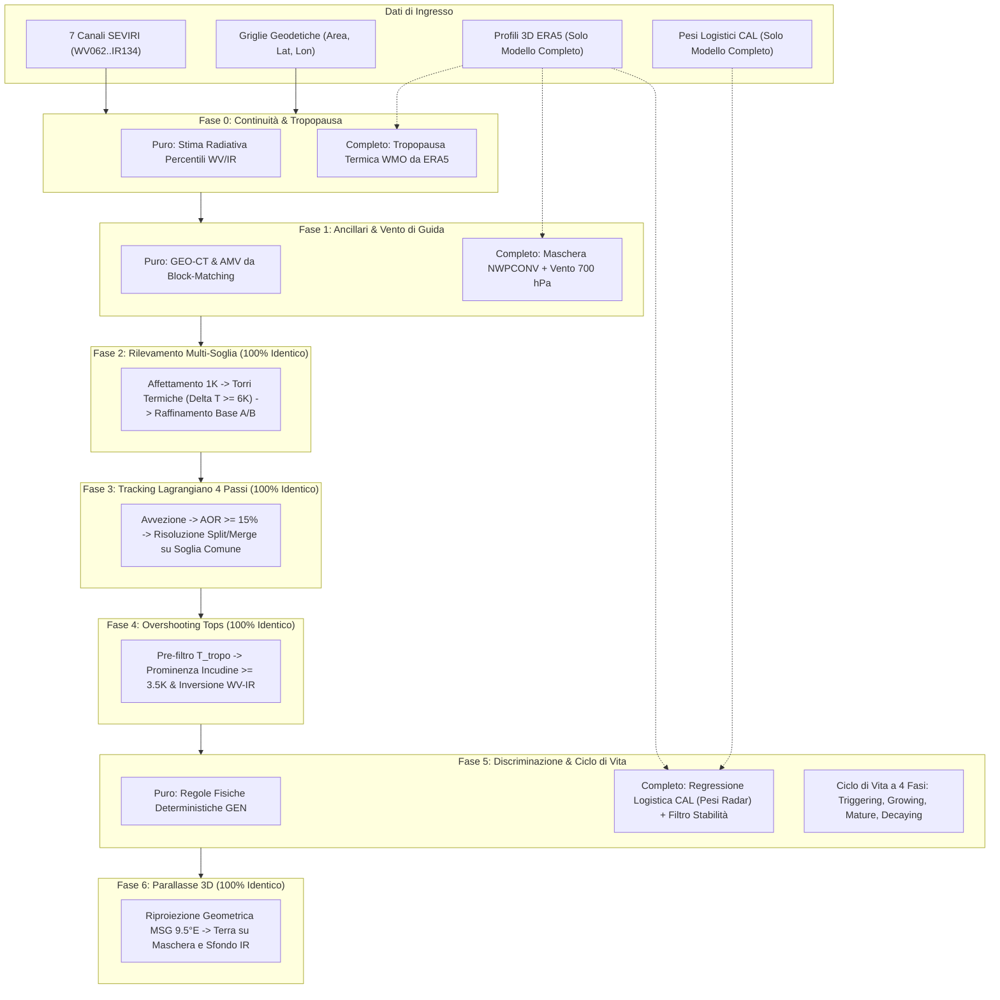

# Algorithm Theoretical Basis Document (ATBD): Modelli RDT Puro e Completo a 7 Canali Termici SEVIRI
### `nwcsaf_rdt_seviri_pure_gen` (Puro SEVIRI) & `nwcsaf_rdt_full_era5_cal` (Completo Multimodale)

**Riferimenti Normativi Ufficiali:**
- EUMETSAT NWC SAF, *Algorithm Theoretical Basis Document for Convection Products (RDT-CW and CI)*, `NWC/CDOP2/GEO/MFT/SCI/ATBD/Convection`, Issue 2, Rev. 1 (v2.1, 2019) & Issue 1, Rev. 1 (v1.1, 2016).
- EUMETSAT NWC SAF, *Product User Manual for Convection Products*, `NWC/CDOP3/GEO/MF-PI/SCI/UM/Convection`, Issue 1, Rev. 0 (v1.0, 2019).

**Moduli Eseguibili di Riferimento nel Repository:**
- [`RDT_original/rdt_nwcsaf/config.py`](file:///c:/Users/Daniele.LOKI/Documents/Progetti/deep_convection/RDT_original/rdt_nwcsaf/config.py): Configurazione e parametri canonici NWC SAF.
- [`RDT_original/rdt_nwcsaf/pipeline.py`](file:///c:/Users/Daniele.LOKI/Documents/Progetti/deep_convection/RDT_original/rdt_nwcsaf/pipeline.py): Tracker causale unificato (`NwcSafRdtTracker`).
- [`RDT_original/rdt_nwcsaf/ancillary.py`](file:///c:/Users/Daniele.LOKI/Documents/Progetti/deep_convection/RDT_original/rdt_nwcsaf/ancillary.py): Prodotti ancillari interni puro-IR (`GEO-CT`, `GEO-HRW`) e parallasse 3D.
- [`RDT_original/rdt_nwcsaf/nwp_era5.py`](file:///c:/Users/Daniele.LOKI/Documents/Progetti/deep_convection/RDT_original/rdt_nwcsaf/nwp_era5.py): Fusione profili verticali ERA5, tropopausa WMO e instabilità `NWPCONV`.
- [`RDT_original/rdt_nwcsaf/detection.py`](file:///c:/Users/Daniele.LOKI/Documents/Progetti/deep_convection/RDT_original/rdt_nwcsaf/detection.py): Multi-slicing a 1 K e raffinamento morfologico delle torri.
- [`RDT_original/rdt_nwcsaf/tracking.py`](file:///c:/Users/Daniele.LOKI/Documents/Progetti/deep_convection/RDT_original/rdt_nwcsaf/tracking.py): Tracking lagrangiano a 4 passi e risoluzione split/merge.
- [`RDT_original/rdt_nwcsaf/otd.py`](file:///c:/Users/Daniele.LOKI/Documents/Progetti/deep_convection/RDT_original/rdt_nwcsaf/otd.py): Rilevamento a due stadi degli Overshooting Tops.
- [`RDT_original/rdt_nwcsaf/discrimination.py`](file:///c:/Users/Daniele.LOKI/Documents/Progetti/deep_convection/RDT_original/rdt_nwcsaf/discrimination.py): Discriminazione (`GEN` e `CAL`), ereditarietà e ciclo di vita a 4 fasi.
- [`RDT_original/rdt_nwcsaf/calibration.py`](file:///c:/Users/Daniele.LOKI/Documents/Progetti/deep_convection/RDT_original/rdt_nwcsaf/calibration.py): Pesi logistici $\beta_k$ e calibrazione su radar OPERA.

---

## 1. Sequenza Algoritmica ad Alto Livello (Sintesi Esecutiva)

### 1.0 Unità Architetturale: Perché il Modello Completo è un Sovrainsieme Stretto (*Strict Superset*) del Modello Puro

I due modelli implementati condividono al **100% l'ossatura computazionale, geometrica e fisica**:
- **Identico algoritmo di rilevamento**: gerarchia ad albero `ThresholdSliceHierarchy` a passi di $1\text{ K}$, criterio di prominenza di torre $\Delta T_{\text{tower}} \ge 6\text{ K}$, separazione alla soglia di biforcazione $T_{\text{merge}} - 1\text{ K}$ e raffinamento morfologico della base (Casi A e B).
- **Identico motore di tracking lagrangiano**: concatenazione a 4 passi (avvezione in avanti, block-matching locale, avvezione all'indietro, dilatazione per piccole celle), risoluzione di split/merge tramite la superficie alla **soglia termica comune** e smussamento esponenziale della velocità ($\alpha = 0.5$).
- **Identico rilevamento Overshooting Tops (`OTD`)**: procedura a 2 stadi basata su prominenza locale sull'anello dell'incudine ($\ge 3.5\text{ K}$) e inversione stratosferica del vapore acqueo ($\text{WV}_{6.2} - \text{IR}_{10.8} \ge -0.5\text{ K}$).
- **Identico schema di ciclo di vita convettivo**: classificazione in 4 fasi canoniche RDT (`Triggering`, `Growing`, `Mature`, `Decaying`) più nube fredda e OT, con ereditarietà dello stato madre per i frammenti di split.
- **Identica correzione geometrica 3D di parallasse**: riproiezione da satellite geostazionario MSG a terra in funzione della quota geometrica $H_{\text{cloud}}$.

> [!IMPORTANT]
> **Relazione tra i due modelli:** Il Modello Completo (`full_era5_cal`) **non rimuove né modifica alcuna procedura** del Modello Puro (`pure_gen`). Agisce come un'estensione incrementale pura (*strict superset*): inietta informazioni termodinamiche e cinematiche esterne (profili ERA5 a 37 livelli di pressione, venti orizzontali a $700\text{ hPa}$, stabilità convettiva `NWPCONV`) e pesi statistici multivariati calibrati su verità radar OPERA ($\boldsymbol{\beta}_k$) in precisi punti di giunzione algoritmica, mantenendo inalterata la sequenza delle fasi.



---

### 1.1 Le 7 Fasi di Esecuzione nei Due Modelli

Per ciascuno slot temporale $t$ (cadenza nominale di $5\text{ min}$), il tracker esegue le **7 fasi** seguenti:

1. **Fase 0 — Validazione della Continuità Temporale e Riferimento di Tropopausa:**
   - **Baseline Pura (`pure_gen`):** valida che il passo temporale sia causale e regolare ($\Delta t \in [0.5, 16.0]\text{ min}$). Stima la temperatura locale della tropopausa ($T_{\text{tropo,IR}}$) e della superficie ($T_{\text{surf,IR}}$) tramite i percentili freddi e caldi dei canali `WV_062` e `IR_108`.
   - **Estensione Completa (`full_era5_cal`):** inietta la temperatura e la quota della tropopausa termica WMO ($T_{\text{tropo,WMO}}$, criterio lapse-rate $\le 2\text{ K km}^{-1}$ Reichler et al., 2003) e la temperatura superficiale di emissione ($T_{\text{skin}}$) estratte dai profili orari ERA5 a 37 livelli di pressione.

2. **Fase 1 — Prodotti Ancillari di Pre-filtraggio e Campo di Moto di Guida:**
   - **Baseline Pura (`pure_gen`):** genera internamente il prodotto `GEO-CT` (maschera delle nubi opache da Split-Window `IR_108 - IR_120` e spessore ottico `WV_062 - IR_108`) per escludere cirri semitrasparenti e suolo sereno. Calcola il campo vettoriale di spostamento $(\Delta y, \Delta x)$ tramite block-matching normalizzato su `IR_108`/`WV_062`.
   - **Estensione Completa (`full_era5_cal`):** fonde il campo di moto con i venti orizzontali NWP a $700\text{ hPa}$ $(\vec{V}_{700})$ per guidare le celle al primo frame di vita, e pre-calcola la maschera di instabilità convettiva `NWPCONV` ($LI \le -3$, $KI \ge 30$, $SHW \le -3$, CAPE).

3. **Fase 2 — Rilevamento Adattivo Multi-Soglia e Raffinamento Morfologico (Identica nei due modelli):**
   - Maschera i pixel non validi o con pixel area eccessivamente distorta ($A > 5 \cdot A_{\text{nom}}$).
   - Costruisce la gerarchia termica `ThresholdSliceHierarchy` su `IR_108` da $T_{\text{warm}} = 278.15\text{ K}$ a $T_{\text{cold}} = 198.15\text{ K}$ a passi di $1\text{ K}$.
   - Isola le singole torri termiche ($\Delta T_{\text{tower}} \ge 6\text{ K}$, $S \ge 60\text{ km}^2$), separando le torri coalescenti alla soglia $T_{\text{merge}} - 1\text{ K}$ e fermando la discesa a `LIMITTROPO`.
   - Raffina la base della torre (`Base of Tower`) eliminando banchi stratiformi piatti tramite i criteri Caso A (strozzatura $S_{n+1}/S_n \le 0.70$) e Caso B (piramidale $S_{\text{BT}} \le 4 \cdot S_{\text{ST}}$).

4. **Fase 3 — Tracking Lagrangiano a 4 Passi e Gestione Traiettorie (Identica nei due modelli):**
   - Cascata a 4 stadi: (1) avvezione in avanti $+\vec{V}\Delta t$ con test di overlap $\text{AOR} \ge 15\%$; (2) block-matching `IR_108` per celle orfane; (3) avvezione all'indietro $-\vec{V}_{\text{est}}\Delta t$; (4) dilatazione $3\times 3$ per celle nascenti ($\le 5\text{ px}$).
   - Risolve topologie di split/merge identificando il *Main Father* tramite la superficie alla **soglia termica comune** $T_{\text{common}} = \min(T_{\text{BT}}(t), T_{\text{BT}}(t-\Delta t))$. Smussamento esponenziale di $\vec{V}$ con coefficiente $\alpha = 0.5$.

5. **Fase 4 — Rilevamento a Due Stadi degli Overshooting Tops (`OTD`, Identica nei due modelli):**
   - Stadio 1: pre-identificazione dei minimi regionali freddi sotto la soglia tropopausa ($T_{\min} \le T_{\text{tropo}} + 3\text{ K}$).
   - Stadio 2: conferma morfologico-radiativa per prominenza rispetto all'anello dell'incudine ($\ge 3.5\text{ K}$) o inversione stratosferica di vapore acqueo ($\text{WV}_{6.2} - \text{IR}_{10.8} \ge -0.5\text{ K}$).

6. **Fase 5 — Discriminazione Convettiva, Ereditarietà e Ciclo di Vita a 4 Fasi:**
   - **Baseline Pura (`pure_gen`):** assegna la cella a una delle 6 categorie verticali (`Cat 0: Mature` .. `Cat 5: Warm`) e valuta i criteri fisici deterministici `GEN` (tasso di raffreddamento $\Delta T_{\min}/\Delta t$, espansione areale a soglia comune $\frac{1}{S}\frac{\Delta S}{\Delta t}$, gradienti periferici e coerenza spettrale `SIG`).
   - **Estensione Completa (`full_era5_cal`):** calcola il vettore dei 12 predittori normalizzati $\mathbf{X}$ e valuta il punteggio logistico calibrato $S = \boldsymbol{\beta}^T \mathbf{X}$ addestrato su verità radar OPERA. Applica il filtro di stabilità `NWPCONV` (inibisce falsi allarmi su fronti freddi stabili) e integra le fulminazioni $LGH$ (forzatura convettiva se presenti).
   - **Ciclo di Vita (Identico nei due modelli):** determina la Fase di Sviluppo a 4 stati secondo RDT Tabella 8 (`Triggering`, `Growing`, `Mature`, `Decaying`), con ereditarietà dello stato madre per `split_new`, e mappa nei codici semantici canonici:
     - `Classe 0`: Sfondo / cielo sereno
     - `Classe 1`: Nube fredda non convettiva (Blu acciaio)
     - `Classe 2`: Convezione — **Triggering** (Giallo brillante, RGB `250, 204, 21`)
     - `Classe 3`: Convezione — **Growing** (Arancione vivace, RGB `249, 115, 22`)
     - `Classe 4`: Convezione — **Mature** (Rosso vivo, RGB `220, 38, 38`)
     - `Classe 5`: Convezione — **Decaying** (Rosso mattone / bordeaux, RGB `153, 27, 27`)
     - `Classe 6`: **Overshooting Top (OT)** (Magenta brillante, RGB `245, 105, 255`)

7. **Fase 6 — Previsione Lagrangiana e Correzione 3D di Parallasse:**
   - Previsione cinematica delle traiettorie a $+15, +30, +45, +60\text{ min}$.
   - Proiezione geometrica 3D dal punto di vista satellitare MSG ($9.5^\circ\text{E}$) alla vera coordinata al suolo:
     - *Nel Modello Puro:* quota $H_{\text{cloud}}$ derivata dal gradiente standard $6.5\text{ K/km}$ rispetto al $T_{\text{surf}}$ radiativo.
     - *Nel Modello Completo:* quota $H_{\text{cloud}}$ derivata dai profili verticali geopotenziali/temperatura ERA5.
     - In entrambi i modelli, la parallasse viene applicata sia alle maschere che all'immagine IR di sfondo per garantire una perfetta coincidenza geometrica senza artefatti di bordo.

---

## 2. Sequenza Algoritmica di Basso Livello (Specifica Dettagliata e Pseudocodice)

Di seguito è riportata la specifica matematica e algoritmica passo-passo, aderente alle funzioni eseguibili del codice.

### Fase 0 — Continuità Temporale e Riferimento di Tropopausa
**Riferimento codice:** [`NwcSafRdtTracker.step_frame`](file:///c:/Users/Daniele.LOKI/Documents/Progetti/deep_convection/RDT_original/rdt_nwcsaf/pipeline.py#L110-L128) e [`fetch_era5_europe_hour`](file:///c:/Users/Daniele.LOKI/Documents/Progetti/deep_convection/RDT_original/rdt_nwcsaf/nwp_era5.py#L85-L160)

```text
PROCEDURA Fase0_Inizializzazione_Slot(frame_7ch, timestamp, stato_precedente, cfg, era5_grid=NULL):
    1. Converti timestamp in minuti UTC: t_curr = _to_timestamp_minutes(timestamp)
    2. SE stato_precedente.t_prev è NULLO:
           dt_min = cfg.expected_cadence_minutes   # 5.0 min
           has_valid_prev = FALSO
       ALTRIMENTI:
           dt_min = t_curr - stato_precedente.t_prev
           has_valid_prev = (0.5 <= dt_min <= 3.0 * cfg.expected_cadence_minutes + 1.0)
           SE NON has_valid_prev:
               SVUOTA stato_precedente (prev_labels, prev_cells, prev_hierarchy, track_histories)
               dt_min = cfg.expected_cadence_minutes

    3. SE cfg.discri_scheme == "CAL" AND era5_grid NON È NULLO:
           # MODELLO COMPLETO: Tropopausa fisica WMO e temperatura superficiale da ERA5
           T_tropo_k = era5_grid.t_tropo_k    # griglia 2D [K]
           T_surf_k  = era5_grid.t_surf_k     # griglia 2D [K]
       ALTRIMENTI:
           # MODELLO PURO: Stima radiativa autonoma dai percentili freddi del frame
           maschera_fredda = isfinite(IR_108) AND (IR_108 < 235.0 K)
           SE count(maschera_fredda) >= 50:
               T_tropo_est = 0.6 * Percentile_10(WV_062[maschera_fredda]) + 0.4 * Percentile_5(IR_108[maschera_fredda])
           ALTRIMENTI:
               T_tropo_est = Percentile_5(WV_062)
           T_tropo_k = clip(T_tropo_est, 205.0 K, 226.0 K)
           T_surf_k  = clip(Percentile_92(IR_108), 280.0 K, 308.0 K)

    RITORNA (dt_min, has_valid_prev, T_tropo_k, T_surf_k)
```

---

### Fase 1 — Prodotti Ancillari (`GEO-CT`, `GEO-HRW` e Vento NWP)
**Riferimento codice:** [`compute_nwcsaf_cloud_type`](file:///c:/Users/Daniele.LOKI/Documents/Progetti/deep_convection/RDT_original/rdt_nwcsaf/ancillary.py#L43-L141), [`compute_hrw_amv_guess_field`](file:///c:/Users/Daniele.LOKI/Documents/Progetti/deep_convection/RDT_original/rdt_nwcsaf/ancillary.py#L144-L259) e [`interpolate_era5_to_seviri_grid`](file:///c:/Users/Daniele.LOKI/Documents/Progetti/deep_convection/RDT_original/rdt_nwcsaf/nwp_era5.py#L163-L220)

```text
PROCEDURA Fase1_Prodotti_Ancillari(curr_frame, prev_frame, T_tropo_k, T_surf_k, era5_grid=NULL):
    # 1.1 Pre-filtraggio Cloud Type (GEO-CT, identico nei due modelli)
    btd_sw = curr_frame[IR_108] - curr_frame[IR_120]
    btd_87_108 = curr_frame[IR_087] - curr_frame[IR_108]
    btd_wv_ir = curr_frame[WV_062] - curr_frame[IR_108]
    dT_surf = T_surf_k - curr_frame[IR_108]

    is_clear = (dT_surf < 6.0 K) AND (btd_sw < 2.2 K) AND (btd_wv_ir < -18.0 K)
    is_cirrus = (NOT is_clear) AND (curr_frame[IR_108] < 263.15 K) AND (
        (btd_sw > 2.8 K AND btd_wv_ir < -10.0 K) OR
        (btd_sw > 2.0 K AND btd_87_108 > -0.5 K AND curr_frame[IR_108] > 228.0 K AND btd_wv_ir < -12.0 K)
    )
    opaque_cloud_mask = BinaryDilation_3x3((NOT is_clear) AND (NOT is_cirrus)) AND (NOT is_clear)

    # 1.2 Campo di moto iniziale (Guess Motion Field)
    SE prev_frame È DISPONIBILE:
        (amv_dy, amv_dx) = BlockMatching_AMV(prev_frame, curr_frame)
    ALTRIMENTI:
        (amv_dy, amv_dx) = (zeros(H, W), zeros(H, W))

    SE era5_grid NON È NULLO:
        # MODELLO COMPLETO: Fusione AMV con vento orizzontale ERA5 a 700 hPa
        # Il vento NWP colma i vuoti dove la nube non presenta tessitura sufficiente per il block-matching
        u700_px = era5_grid.u700_m_per_s * (dt_min * 60.0) / dx_step_m
        v700_px = era5_grid.v700_m_per_s * (dt_min * 60.0) / dy_step_m
        guess_dy = where(hypot(amv_dy, amv_dx) > 0.5, amv_dy, -v700_px)
        guess_dx = where(hypot(amv_dy, amv_dx) > 0.5, amv_dx,  u700_px)
        nwp_mask = era5_grid.nwpconv_mask   # 0: Stabile, 1: Indeterminato, 2: Instabile (NWPCONV)
    ALTRIMENTI:
        # MODELLO PURO: Solo AMV da satellite, nessun vincolo NWP
        guess_dy = amv_dy
        guess_dx = amv_dx
        nwp_mask = full((H, W), 2)   # Disabilita il filtro di instabilità (default neutrale)

    RITORNA (opaque_cloud_mask, guess_dy, guess_dx, nwp_mask)
```

---

### Fase 2 — Rilevamento Adattivo Multi-Soglia e Raffinamento Morfologico (Identica nei due modelli)
**Riferimento codice:** [`ThresholdSliceHierarchy`](file:///c:/Users/Daniele.LOKI/Documents/Progetti/deep_convection/RDT_original/rdt_nwcsaf/detection.py#L28-L143) e [`detect_rdt_cells`](file:///c:/Users/Daniele.LOKI/Documents/Progetti/deep_convection/RDT_original/rdt_nwcsaf/detection.py#L169-L633)

#### Parametri Canonici (ATBD §3.2.1.2.1, UM Tabella 5)
- $T_{\text{warm}} = 278.15\text{ K}$ ($+5^\circ\text{C}$), $T_{\text{cold}} = 198.15\text{ K}$ ($-75^\circ\text{C}$), $\Delta T = 1.0\text{ K}$ (80 livelli termici).
- Prominenza minima torre: $\Delta T_{\text{tower}} = T_{\text{BT}} - T_{\min} \ge 6.0\text{ K}$.
- Area minima e massima: $S_{\min} = 60.0\text{ km}^2$, $S_{\max} = 400\,000.0\text{ km}^2$.
- Limite pavimento torre: $T_{\text{BTLIMIT}} = 213.15\text{ K}$ ($-60^\circ\text{C}$).
- Rapporto strozzatura verticale (Caso A): $r_{\max} = 0.70$ per $T \ge 238.15\text{ K}$ ($-35^\circ\text{C}$).
- Rapporto areale Base/Top (Caso B): $R_{\text{BT/ST}} = 4.0$, con $S_{\text{ST}} \approx \text{area}(T_{\min} + 6\text{ K})$.

```text
PROCEDURA Fase2_Detect_RDT_Cells(frame_7ch, area_km2, opaque_cloud_mask, T_tropo_k, cfg):
    1. valid_mask = isfinite(frame_7ch).all(axis=0) AND opaque_cloud_mask AND (area_km2 > 0)
    2. hierarchy = ThresholdSliceHierarchy(IR_108, area_km2, valid_mask, cfg)

    3. FUNZIONE _descend(bbox, loc_mask, T_soglia, T_min_comp, is_isolated_single_tower):
           floor_k = cfg.btlimit_k   # 213.15 K
           SE cfg.limittropo:
               floor_k = max(floor_k, mediana(T_tropo_k[bbox][loc_mask]))
           bt_floor_k = max(cfg.tcold_k, floor_k, T_min_comp + 6.0 K)

           PER T_low DA (T_soglia - 1.0 K) A bt_floor_k PASSO -1.0 K:
               (child_labels, child_areas, child_minima, child_bboxes) = hierarchy.slice_at_with_bboxes(T_low)
               valid_children = [
                   cid PER cid IN unique(child_labels[bbox][loc_mask]) > 0
                   SE child_areas[cid] >= 60.0 km^2 AND (T_low - child_minima[cid]) >= 6.0 K
               ]
               SE len(valid_children) >= 2:
                   # BIFORCAZIONE: separazione sorelle alla soglia T_low = T_merge - 1 K
                   PER OGNI cid IN valid_children:
                       _descend(child_bboxes[cid], child_labels == cid, T_low, child_minima[cid], FALSO)
                   RITORNA

           # TORRE SINGOLA: Raffinamento base della torre
           seed_yx = argmin(IR_108[loc_mask])
           T_ST = min(T_soglia, T_min + 6.0 K)
           S_ST = hierarchy.area_containing_seed(T_ST, seed_yx)
           S_BT = sum(area_km2[bbox][loc_mask])
           T_BT_ref = T_soglia

           # Caso A: Strozzatura verticale su banchi caldi piatti (T >= -35 C)
           SE S_ST >= 60.0 km^2:
               livelli = [T_BT_ref, T_BT_ref - 1K, ..., bt_floor_k]
               aree = [hierarchy.area_containing_seed(lv, seed_yx) PER lv IN livelli]
               rapporti = [aree[i+1] / aree[i] PER i SE livelli[i] >= 238.15 K]
               SE min(rapporti) <= 0.70:
                   T_BT_ref = livello_strozzatura

               # Caso B: Vincolo piramidale S_BT <= 4 * S_ST
               SE S_BT > 4.0 * S_ST:
                   T_BT_ref = primo_livello CON area <= 4.0 * S_ST

           REGISTRA cella convettiva con contorno a T_BT_ref e vertice T_min
```

---

### Fase 3 — Tracking Lagrangiano e Risoluzione Split/Merge (Identica nei due modelli)
**Riferimento codice:** [`track_rdt_cells`](file:///c:/Users/Daniele.LOKI/Documents/Progetti/deep_convection/RDT_original/rdt_nwcsaf/tracking.py#L287-L514)

```text
PROCEDURA Fase3_Track_RDT_Cells(prev_cells, curr_cells, guess_motion_yx, dt_min, cfg):
    # PASSO 1: Avvezione in avanti + V * dt
    PER OGNI p_id IN prev_cells:
        maschera_avanti = Trasla(p_cell.mask, +round(p_cell.velocity * dt_min))
        PER OGNI c_id IN curr_cells che interseca maschera_avanti:
            AOR = Intersection(maschera_avanti, c_cell.mask) / min(Area(p), Area(c))
            SE AOR >= 0.15:
                Registra_Link(p_id -> c_id, step=1)

    # PASSO 2: Block-matching di recupero per celle orfane
    PER OGNI c_id rimasta orfana:
        v_est = BlockMatching_Locale(curr_ir, prev_ir, c_cell.seed_yx)
        SE rho_max >= 0.50:
            maschera_indietro = Trasla(c_cell.mask, -round(v_est * dt_min))
            PER OGNI p_id CON Overlap(maschera_indietro, p_cell.mask) >= 0.15:
                Registra_Link(p_id -> c_id, step=2)

    # PASSO 4: Dilatazione 3x3 per piccole celle nascenti (<= 5 pixel)
    PER OGNI c_id orfana CON c_cell.pixel_count <= 5:
        maschera_dil = Dilate_3x3(c_cell.mask)
        PER OGNI p_id CON Overlap(maschera_dil, p_cell.mask) >= 0.15:
            Registra_Link(p_id -> c_id, step=4)

    # RISOLUZIONE DI SPLIT E MERGE TRAMITE SOGLIA COMUNE (ATBD Sec 3.2.1.2.2)
    # Per ogni coppia collegata, T_common = min(T_BT(padre), T_BT(figlia)):
    #   - In un MERGE (più padri -> una figlia): il Padre Principale (Main Father) è quello con
    #     la massima superficie alla soglia comune: argmax_{p_i} Area(p_i, T_common).
    #   - In uno SPLIT (un padre -> più figlie): la Figlia Principale (Main Child, che conserva
    #     il track_id) è quella con la massima superficie alla soglia comune: argmax_{c_j} Area(c_j, T_common).
    #     Le figlie secondarie ("split_child") ricevono nuovo track_id ed ereditano lo stato vitale della madre.

    # Smussamento esponenziale della velocità:
    V_smoothed = 0.5 * V_raw + 0.5 * V_precedente_padre
    RITORNA (parents, children, primary_parent, events)
```

---

### Fase 4 — Rilevamento Overshooting Tops (`OTD`, Identica nei due modelli)
**Riferimento codice:** [`detect_cell_overshooting_tops`](file:///c:/Users/Daniele.LOKI/Documents/Progetti/deep_convection/RDT_original/rdt_nwcsaf/otd.py#L23-L185)

```text
PROCEDURA Fase4_Detect_Overshooting_Tops(cell, frame_7ch, T_tropo_k, cfg):
    # Stadio 1: Pre-selezione minimi locali sotto soglia
    T_ref_ot = min(223.15 K, T_tropo_k + 3.0 K)
    SE cell.t_min_k > T_ref_ot:
        RITORNA Nessun_OT

    # Stadio 2: Conferma radiativo-morfologica
    PER OGNI candidato OT c_ot:
        T_anvil = Mediana(IR_108 sull'anello circostante a distanza 2..5 pixel)
        prominenza = T_anvil - c_ot.t_min_k
        btd_wv_ir = max(WV_062 - IR_108 su c_ot)

        # Criteri congiunti di perforazione tropopausa e inversione stratosferica:
        SE (c_ot.t_min_k <= T_tropo_k + 1.5 K AND prominenza >= 3.5 K) OR
           (btd_wv_ir >= -0.5 K AND prominenza >= 2.2 K):
            Conferma c_ot come Overshooting Top
    RITORNA (confirmed_mask, confirmed_count)
```

---

### Fase 5 — Discriminazione Convettiva (`GEN` vs `CAL`) e Ciclo di Vita a 4 Fasi
**Riferimento codice:** [`discriminate_and_classify_cell`](file:///c:/Users/Daniele.LOKI/Documents/Progetti/deep_convection/RDT_original/rdt_nwcsaf/discrimination.py#L275-L515) e [`calibration.py`](file:///c:/Users/Daniele.LOKI/Documents/Progetti/deep_convection/RDT_original/rdt_nwcsaf/calibration.py#L69-L210)

```text
PROCEDURA Fase5_Discriminate_And_Classify(cell, prev_cell, conv_parent, history, ot_res, cfg, cal_model=NULL, nwp_mask=2):
    cat = classify_vertical_category(cell.t_min_k, cell.t_bt_k, eta_traiettoria)

    # 5.1 Valutazione Convettiva: Puro GEN vs Completo CAL
    SE cfg.discri_scheme == "CAL" AND cal_model NON È NULLO:
        # MODELLO COMPLETO: Regressione logistica multivariata calibrata su radar OPERA
        SE cfg.nwp_conv_filter AND nwp_mask == 0:
            is_conv_stat = FALSO   # Bloccato dal filtro di stabilità NWP (atmosfera stabile LI > 0)
        ALTRIMENTI:
            # Vettore dei 12 predittori fisici normalizzati X_0..X_11 (cfr. Sezione 3)
            X = Calcola_Vettore_Predittori_12(cell, history, cat)
            regime_key = f"{cat}_{has_history}"
            beta = cal_model.weights[regime_key]
            logit_score = beta_0 + sum_{i=1..11} beta_i * X_i
            P_conv = 1.0 / (1.0 + exp(-logit_score))
            is_conv_stat = (P_conv >= cal_model.thresholds[cat])
    ALTRIMENTI:
        # MODELLO PURO: Regole fisiche deterministiche senza calibrazione radar
        is_conv_stat = Valuta_Criteri_Fisici_GEN(cell, history, cat)

    # 5.2 Ereditarietà e declassificazione
    inherited_conv = (conv_parent NON È NULLO) AND conv_parent.is_convective
    SE inherited_conv AND Criterio_Dissipazione_Verificato(cell, history):
        inherited_conv = FALSO

    is_convective = is_conv_stat OR inherited_conv OR (ot_res.confirmed_count > 0)

    # 5.3 Fase di Sviluppo RDT (ATBD Tabella 8, p. 51):
    SE NON is_convective:
        phase_code = -1; class_id = 1   # Classe 1: Nube fredda non convettiva (Blu acciaio)
    ALTRIMENTI:
        SE cell.event == "split_new":
            phase_code = mother_cell.phase_code   # Eredita fase dalla madre
        ALTRIMENTI SE cell.event IN ("new", "complex"):
            phase_code = 0   # Triggering
        ALTRIMENTI:
            cooling_rate = cell.cooling_rate_15m   # [K/h]
            d_area = cell.area_change_15m          # [km^2]
            is_mature = (cat == 0) OR (cell.t_min_k <= 216.0 K)

            SE cooling_rate > +2.0 K/h:    # Raffreddamento attivo (updraft)
                phase_code = 1 SE (NOT is_mature OR d_area > 0) ALTRIMENTI 2   # Growing / Mature
            ALTRIMENTI SE |cooling_rate| <= 2.0 K/h:   # Top stazionario
                phase_code = 2 SE is_mature ALTRIMENTI (1 SE d_area > 0 ALTRIMENTI 3)
            ALTRIMENTI:    # Riscaldamento (downdraft / collasso)
                phase_code = 2 SE (is_mature AND (-cooling_rate <= 5.0 K/h)) ALTRIMENTI 3   # Decaying

        SE phase_code == 0: class_id = 2   # Triggering (Giallo brillante, RGB: 250, 204, 21)
        SE phase_code == 1: class_id = 3   # Growing (Arancione vivace, RGB: 249, 115, 22)
        SE phase_code == 2: class_id = 4   # Mature (Rosso vivo, RGB: 220, 38, 38)
        SE phase_code == 3: class_id = 5   # Decaying (Rosso mattone, RGB: 153, 27, 27)

    # Sovrascrittura pixel OT
    SE is_convective AND ot_res.confirmed_count > 0:
        maschera_pixel_ot = 6              # Classe 6: OT (Magenta fluorescente, RGB: 245, 105, 255)
    RITORNA (is_convective, phase_code, class_id)
```

---

### Fase 6 — Previsione Lagrangiana e Correzione 3D di Parallasse
**Riferimento codice:** [`apply_parallax_correction_2d`](file:///c:/Users/Daniele.LOKI/Documents/Progetti/deep_convection/RDT_original/rdt_nwcsaf/ancillary.py#L262-L344) e [`fill_internal_mask_holes`](file:///c:/Users/Daniele.LOKI/Documents/Progetti/deep_convection/RDT_original/scripts/run_september_week_full_domain.py#L215-L230)

```text
PROCEDURA Fase6_Parallax_Correction_2D(raster_2d, ir_frame, lat_deg, lon_deg, T_surf_k, T_tropo_k):
    1. # Quota geometrica della sommità nuvolosa H_cloud (m)
       # Nel modello puro: gradiente adiabatico standard 6.5 K/km rispetto a T_surf_k radiativo
       # Nel modello completo: integrato lungo il profilo geopotenziale ERA5
       H_cloud_m = clip((T_surf_k - ir_frame) / 0.0065, 0.0 m, 14500.0 m)

    2. # Geometria geostazionaria MSG a 9.5°E (r_sat = 42,164 km, R_eq = 6,378.169 km)
       xx = R_eq * cos(rad(lat_deg)) * sin(rad(lon_deg - 9.5))
       yy = R_eq * sin(rad(lat_deg))
       z_earth = sqrt(max(R_eq^2 - xx^2 - yy^2, (0.28 * R_eq)^2))
       geom_factor = (r_sat / (r_sat - z_earth)) / z_earth

       # Traslazione al suolo lungo il vettore di vista satellite
       dr = round(-H_cloud_m * yy * geom_factor / dy_step_m)
       dc = round(-H_cloud_m * xx * geom_factor / dx_step_m)

    3. # Spostamento coordinato: sia la maschera semantica che lo sfondo IR vengono proiettati al suolo
       # per garantire la coincidenza al singolo pixel ed evitare contorni bianchi spaiati
       sem_ground = ForwardSplatting(raster_2d, dr, dc)
       ir_ground  = ForwardSplatting(ir_frame, dr, dc)

    4. # Sigillatura morfologica dei micro-buchi interni da coordinate discrete (<= 16 pixel)
       sem_ground_sealed = fill_internal_mask_holes(sem_ground, max_hole_size=16)

    RITORNA (sem_ground_sealed, ir_ground)
```

---

## 3. Confronto Architetturale: Differenze Algoritmiche tra Modello Puro e Completo, Formulazione Matematica `CAL` e Specifiche Operative NWC SAF

### 3.1 Formulazione Matematica dello Schema Calibrato `CAL` nel Modello Completo

Nel **Modello Completo (`full_era5_cal`)**, la probabilità convettiva di una cella non è valutata mediante soglie empiriche fisse come in `GEN`, ma mediante un discriminatore logistico multivariato:

$$P(\text{conv}) = \frac{1}{1 + e^{-S}}, \qquad S = \beta_0 + \sum_{i=1}^{11} \beta_i \cdot X_i$$

I **12 predittori fisici normalizzati** $\mathbf{X} = (X_0, \dots, X_{11})$ derivati dai 7 canali SEVIRI e dai trend temporali sono:

| Indice $i$ | Nome Predittore | Definizione Matematica | Significato Fisico |
| :---: | :--- | :--- | :--- |
| $X_0$ | `bias` | $1.0$ | Termine noto di calibrazione ($\beta_0$) |
| $X_1$ | `tropo_excess_10k` | $\frac{T_{\text{tropo}} - T_{\min}}{10.0\text{ K}}$ | Penetrazione della tropopausa / galleggiamento verticale residuo |
| $X_2$ | `contrast_10k` | $\frac{T_{\text{surf}} - T_{\min}}{10.0\text{ K}}$ | Spessore termico complessivo della nube rispetto al suolo |
| $X_3$ | `tower_dt_20k` | $\frac{T_{\text{BT}} - T_{\min}}{20.0\text{ K}}$ | Prominenza della torre convettiva rispetto alla base dell'incudine |
| $X_4$ | `grad_p95_2k` | $\frac{\text{GradP}_{95}}{2.0\text{ K/km}}$ | Ripidezza dei bordi periferici (marcatore di updraft vigoroso non stratiforme) |
| $X_5$ | `btd_62_108_norm` | $\frac{\text{WV}_{6.2} - \text{IR}_{10.8} + 5.0}{10.0}$ | Spessore ottico troposferico e iniezione di vapore in stratosfera |
| $X_6$ | `wbtd_62_73_norm` | $\frac{\text{WV}_{6.2} - \text{WV}_{7.3} + 15.0}{15.0}$ | Differenza tra vapore alto e medio (umidificazione verticale della colonna) |
| $X_7$ | `btd_108_120_opaque` | $\text{clip}\!\left(\frac{\text{IR}_{10.8} - \text{IR}_{12.0} - 0.5}{2.0},\ 0,\ 1\right)$ | Split-Window: discriminazione tra nube otticamente spessa e cirro sottile |
| $X_8$ | `btd_87_108_ice` | $\frac{\text{IR}_{8.7} - \text{IR}_{10.8} + 2.0}{4.0}$ | Assorbimento differenziale del ghiaccio (glaciazione della sommità) |
| $X_9$ | `cooling_rate_norm` | $\frac{-\dot{T}_{\min}(15\text{m})}{10.0\text{ K/h}}$ | Velocità ascensionale della sommità della nube (tasso di raffreddamento) |
| $X_{10}$ | `expansion_rate_norm` | $\frac{\dot{S}_{\text{rel}}(15\text{m})}{100.0\%\text{ h}^{-1}}$ | Tasso di divergenza orizzontale dell'incudine alla soglia comune |
| $X_{11}$ | `wv_trend_norm` | $\frac{\Delta\text{BTD}_{\text{WV-IR}}(15\text{m})}{5.0\text{ K/h}}$ | Trend di opacizzazione del canale vapore acqueo |

I vettori dei pesi $\boldsymbol{\beta}$ sono stratificati per **6 categorie verticali** $\times$ **4 regimi di profondità storica** ($0\text{ min}$, $15\text{ min}$, $30\text{ min}$, $\ge 45\text{ min}$), generando 24 modelli logistici indipendenti addestrati con penalizzazione $L_2$ contro i nuclei riflettenti a terra misurati dalla rete radar OPERA ($\ge 35\text{ dBZ}$).

---

### 3.2 Tabella Sinottica Comparativa: Puro SEVIRI vs Completo vs Specifiche Ufficiali NWC SAF

| Componente Algoritmica | Modello **Puro SEVIRI (`pure_gen`)** | Nostro Modello **Completo (`full_era5_cal`)** | Vero **RDT Operativo (NWC SAF Ufficiale)** |
| :--- | :--- | :--- | :--- |
| **Architettura Core (Detection, Tracking, OTD, Ciclo di Vita)** | **100% Implementata** conforme ad ATBD v2.1 | **100% Identica al Puro** (Sovrainsieme stretto, nessuna alterazione) | Identica (multi-soglia 1 K, AOR 15%, OTD a 2 stadi, 4 fasi di ciclo vitale) |
| **Dati Satellitari in Ingresso** | **7 canali termici/WV SEVIRI** (Kelvin), omogenei giorno e notte | **7 canali termici/WV SEVIRI** (Kelvin), omogenei giorno e notte | 7 canali termici + opzionali visibili diurni (`VIS0.6`, `VIS0.8`, `HRV` a 1 km) |
| **Temperatura di Tropopausa ($T_{\text{tropo}}$)** | **Stima radiativa autonoma** dai percentili freddi 5°–10° `WV_062`/`IR_108` | **Fisica WMO** calcolata sui profili verticali completi ERA5 ($\Gamma \le 2\text{ K/km}$) | Da modello numerico operativo (ECMWF IFS / Météo-France ARPEGE) |
| **Temperatura Superficiale ($T_{\text{surf}}$)** | **Stima radiativa autonoma** dal 92° percentile `IR_108` sulla scena | **Temperatura di emissione superficiale $T_{\text{skin}}$** da ERA5 | Da modello numerico operativo NWP |
| **Campo di Moto Iniziale (Guess Motion)** | **AMV puro-IR** da block-matching normalizzato su `IR_108` e `WV_062` | **Fusione AMV + Vento orizzontale a 700 hPa** $(\vec{V}_{700})$ da ERA5 | Fusione AMV + Vento orizzontale NWP a 700 hPa |
| **Pre-filtraggio Cloud Type (`GEO-CT`)** | **Interno Puro-IR:** Split-Window, fase ghiaccio e spessore `WV-IR` | **Interno Puro-IR:** Split-Window, fase ghiaccio e spessore `WV-IR` | Pacchetto software ancillare separato NWC SAF `GEO-CMA`/`GEO-CT` |
| **Filtro di Instabilità Termodinamica** | **Disabilitato:** opera senza dati di modello atmosferico | **Attivo (`NWPCONV`):** blocca nubi fredde stabili ($LI \le -3$, $KI \ge 30$, $SHW \le -3$) | Attivo tramite indici di instabilità NWP e campi CAPE |
| **Schema di Discriminazione Convettiva** | **Fisico Generico (`GEN`):** soglie deterministiche su cooling e gradienti | **Statistico Calibrato (`CAL`):** regressione logistica su 12 predittori pesati su radar | Statistico Calibrato (`CAL`) addestrato su radar francesi Météo-France |
| **Dati Fulmini a Terra ($LGH$)** | **Assenti:** i fulmini non sono rilevabili dai canali termici IR | **Assenti:** non utilizzati nel benchmark (reti proprietarie a pagamento) | Opzionali (ATDnet / EUCLID): forzano convettività se presenti $\ge 1\text{--}2$ fulmini |
| **Allineamento Geometrico 3D Parallasse** | **Attivo al suolo** sia su maschere che su sfondo IR (zero bordi bianchi) | **Attivo al suolo** sia su maschere che su sfondo IR (zero bordi bianchi) | Attivo (opzionale, proietta i poligoni dei contorni al suolo) |
| **Autonomia da Dati Esterni** | **100% Autonomo:** solo SEVIRI, zero leakage, zero dipendenze esterne | Richiede reanalisi ERA5 e pesi statistici radar | Richiede modelli NWP operativi, pacchetti CT/HRW e radar/fulmini |
