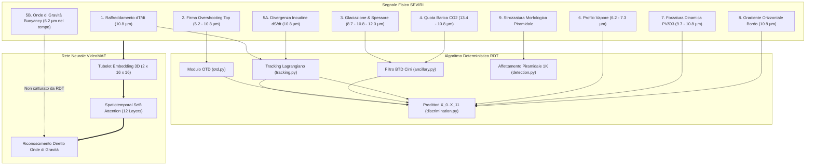

# Principi Fisici dei 7 Canali Termici SEVIRI per la Convezione Profonda e Corrispondenza nell'Algoritmo RDT

Questo documento analizza in dettaglio i fondamenti fisici e termodinamici dei 7 canali infrarossi SEVIRI a bordo di Meteosat Second Generation (MSG) impiegati per il rilevamento delle celle temporalesche convettive, esamina come la copertura nuvolosa viene estratta in [`RDT_original/ATBD_PURE_SEVIRI_RDT.md`](file:///c:/Users/Daniele.LOKI/Documents/Progetti/deep_convection/RDT_original/ATBD_PURE_SEVIRI_RDT.md) e traccia la corrispondenza esatta, riga per riga, con il codice eseguibile del repository.

---

## 1. Come RDT Rileva la Copertura Nuvolosa vs. Sovrastima di `CT_original`

### 1.1 La Maschera Nuvolosa in `RDT_original` (Radiativa Pure-SEVIRI)
A differenza del processore NWC SAF Cloud Mask completo (che fa affidamento su modelli meteorologici numerici NWP, griglie orarie di SST oceanica e atlanti geografici terra-mare ad alta risoluzione), l'algoritmo **Puro SEVIRI** formalizzato in [`RDT_original/ATBD_PURE_SEVIRI_RDT.md`](file:///c:/Users/Daniele.LOKI/Documents/Progetti/deep_convection/RDT_original/ATBD_PURE_SEVIRI_RDT.md) (Sezione 1.1, Fase 1) ed eseguito in [`RDT_original/rdt_nwcsaf/ancillary.py`](file:///c:/Users/Daniele.LOKI/Documents/Progetti/deep_convection/RDT_original/rdt_nwcsaf/ancillary.py#L40-L130) non utilizza modelli esterni né maschere statiche. Esso determina il cielo sereno e le nubi opache attraverso test radiometrici robusti:

```python
# 1. Soglia adattiva cielo sereno / nube ancorata alla stima radiativa del suolo T_surf
clear_thresh = np.minimum(t_surf_arr - 6.0, 280.15)
cloudy = finite & (ir108_f <= clear_thresh)

# 2. Identificazione cielo sereno tramite contrasto e trasparenza vapore acqueo
is_clear = (dT_surf < 6.0 K) & (btd_sw < 2.2 K) & (btd_wv_ir < -18.0 K)

# 3. Identificazione dei cirri sottili semitrasparenti (da escludere)
sw_cirrus_thresh = 2.2 + 0.025 * np.clip(ir108_f - 230.0, 0.0, 45.0)
thin_cirrus = (
    cloudy
    & (ir108_f > 228.15)
    & (ir108_f < 268.15)
    & (btd_108_120 > sw_cirrus_thresh)
    & (btd_062_108 < -11.0)
    & (btd_087_108 > -1.5)
)

# 4. Maschera nubi opache per RDT: esclude sereno e cirri isolati
opaque_cloud_mask = cloudy & (~detached_thin_cirrus)
```

**Verifica quantitativa su scena reale autunnale (`20261027.zarr`, slot 15):**
- **Cielo sereno (Classe 0)**: **53.72%** della scena (oltre metà del dominio è correttamente libero da nubi).
- Nubi basse calde (Classe 1): 27.96%.
- Nubi medie (Classe 2): 11.49%.
- Nubi alte opache (Classi 3 e 4): 5.40%.
- Cirri semitrasparenti (Classe 5): 1.43%.

---

### 1.2 Perché l'Esempio in `CT_original` Sovrastimava le Nubi (~80% nuvoloso e 54% nubi basse)?

L'ispezione analitica del codice ha svelato la causa fisica e algoritmica esatta della sovrastima notata nel video:

1. **Assenza della Land-Sea Mask**: Nel modulo `CT_original/ct_nwcsaf/ancillary.py` (riga 143), se non viene fornita una maschera terra/mare, la variabile di terra viene forzata a zero:
   ```python
   land = np.zeros(shape, dtype=bool)  # Tratta l'intero dominio come MARE
   ```
2. **Attivazione Errata del Test SST Oceanico**: In `cma.py`, il test sulla temperatura superficiale del mare (`STEP 1: Test on SST over Sea`) viene applicato su tutti i pixel marcati come `sea = ~land`. Poiché la terra europea in autunno/inverno ha temperature di brillanza a terra di circa $278 - 282\text{ K}$, mentre la temperatura superficiale del mare (SST) di riferimento climatologico è superiore a $292\text{ K}$, l'algoritmo interpreta la terraferma fredda continentale come "acqua oceanica anomalmente gelata a causa di una nube bassa sovrimposta".
3. **Collasso a 0 Pixel della Classe Sereno su Terra**: In `ct.py`, la classe 1 (`Cloud-Free Land`) richiede `is_clear & land`. Avendo `land = False` ovunque, la classe `Cloud-Free Land` produce **esattamente 0 pixel (0.00%)**.
4. **Accorpamento Massivo nel Regime 1**: Tutta la terraferma europea serena è stata così forzata nelle classi 5 ("Very Low Cloud"), 6 ("Low Opaque Cloud") e 10 ("Fractional Cloud"), che il Piano A aggrega nel Macro-Regime 1 ("Low Cloud", 54.05% della mappa), stendendo un falso lenzuolo azzurro/ciano sull'intero continente.

> [!IMPORTANT]
> Sul canale $10.8\text{ µm}$ la terraferma europea appare chiaramente priva di copertura e trasparente. Il filtro puramente radiometrico a differenze di brillanza (BTD) adottato in `RDT_original` evita questo trabocchetto e preserva la reale copertura nuvolosa.

---

## 2. Le Considerazioni Fisiche dei 7 Canali SEVIRI e la Corrispondenza nel Codice RDT

La tabella sottostante riassume i 7 canali spettrali SEVIRI a bordo di MSG:

| Canale | Lunghezza d'onda centrale | Regione Spettrale | Assorbitore / Fenomeno Principale |
| :--- | :---: | :--- | :--- |
| **`WV_062`** | $6.25\text{ µm}$ | Vapore Acqueo Alto | Emissione vapore troposfera superiore ($300 - 500\text{ hPa}$) |
| **`WV_073`** | $7.35\text{ µm}$ | Vapore Acqueo Medio | Emissione vapore media troposfera ($500 - 700\text{ hPa}$) |
| **`IR_087`** | $8.70\text{ µm}$ | Finestra / Ghiaccio | Firma di fase mista/ghiaccio (Reststrahlen / assorbimento) |
| **`IR_097`** | $9.66\text{ µm}$ | Ozono ($O_3$) | Assorbimento ozono stratosferico (Tropopause folds) |
| **`IR_108`** | $10.80\text{ µm}$ | Finestra Atmosferica Pulita | Temperatura di brillanza sommità nube e superficie |
| **`IR_120`** | $12.00\text{ µm}$ | Split-Window | Assorbimento differenziale vapore/ghiaccio e spessore ottico $\tau$ |
| **`IR_134`** | $13.40\text{ µm}$ | Banda dell'Anidride Carbonica | $CO_2$ slicing per stima quota barica $P_{\text{top}}$ |

---

### Principio 1: Raffreddamento Esplosivo Causale ($\partial T_{\min}/\partial t$)
- **Fisica**: In una cella temporalesca a forte sviluppo verticale, la colonna ascendente (updraft) sale a velocità di $15 - 50\text{ m/s}$. L'espansione adiabatica dell'aria satura durante la risalita causa un brusco raffreddamento della sommità della nube ($T_{\min}$). Tassi di raffreddamento inferiori a $-5\text{ K} / 15\text{ min}$ (equivalenti a oltre $-10\text{ K/h}$) sono il marcatore inequivocabile di convezione vigorosa non stratiforme.
- **Come lo applica RDT**: L'algoritmo non fa una semplice derivata su un singolo pixel (che sarebbe affetta da rumore o dallo spostamento della cella), ma calcola il tasso di raffreddamento **lagrangiano a 15 minuti effettivi** lungo la traiettoria della cella identificata dal tracking AOR:
  $$\dot{T}_{\min}(15\text{m}) = \frac{T_{\min}(t) - T_{\min}(t - 15\text{min})}{\Delta t}$$
  Se la cella ha $\dot{T}_{\min} < -2\text{ K/h}$, viene promossa alla fase attiva (`Growing`); se si riscalda ($\dot{T}_{\min} > +2\text{ K/h}$), entra in dissipazione (`Decaying`).
- **Corrispondenza nel Codice**:
  - Algoritmo di discriminazione: [`RDT_original/rdt_nwcsaf/discrimination.py`](file:///c:/Users/Daniele.LOKI/Documents/Progetti/deep_convection/RDT_original/rdt_nwcsaf/discrimination.py#L125-L165) (funzione `_eval_cooling_growth`, calcolo del predittore normalizzato $X_9$).
  - Modulo estrazione feature: [`src/emma_gpm/rdt/features.py`](file:///c:/Users/Daniele.LOKI/Documents/Progetti/deep_convection/src/emma_gpm/rdt/features.py#L110-L140) (campo `cooling_15min_k`).

---

### Principio 2: Firma Spettrometrica dell'Overshooting Top ($WV_{062} - IR_{108} \ge -0.5\text{ K}$)
- **Fisica**: Nella troposfera la temperatura diminuisce con l'altezza. Pertanto, il canale $WV_{062}$ (che vede gli strati elevati e freddi a $400\text{ hPa}$) è normalmente molto più freddo del canale finestra $IR_{108}$ ($WV_{062} - IR_{108} \le -15\text{ K}$). Quando l'updraft sfonda violentemente la tropopausa ed entra nella stratosfera (Overshooting Top, OT), la cupola convettiva si raffredda adiabaticamente al di sotto della temperatura stratosferica circostante. La stratosfera calda sovrastante, ricca di vapore acqueo iniettato dalla convezione, emette radiazione a $6.2\text{ µm}$ a temperature superiori rispetto al top freddo visto a $10.8\text{ µm}$. Si osserva quindi una celebre **inversione termica radiometrica**:
  $$WV_{062} - IR_{108} \ge 0\text{ K}$$
- **Come lo applica RDT**: Procedura OTD a due stadi:
  1. *Stadio 1*: Pre-filtro dei minimi freddi prossimi alla tropopausa: $T_{\min} \le T_{\text{tropo}} + 3.0\text{ K}$.
  2. *Stadio 2*: Misura della prominenza locale rispetto all'incudine circostante sull'anello a $2 - 5\text{ px}$ ($\Delta T_{\text{prom}} \ge 3.5\text{ K}$) unita alla condizione di inversione stratosferica ($WV_{062} - IR_{108} \ge -0.5\text{ K}$ e prominenza $\ge 2.2\text{ K}$).
- **Corrispondenza nel Codice**:
  - Modulo OTD dedicato: [`RDT_original/rdt_nwcsaf/otd.py`](file:///c:/Users/Daniele.LOKI/Documents/Progetti/deep_convection/RDT_original/rdt_nwcsaf/otd.py#L23-L185) (funzione `detect_cell_overshooting_tops`).
  - Pipeline di classificazione semantica: [`RDT_original/rdt_nwcsaf/discrimination.py`](file:///c:/Users/Daniele.LOKI/Documents/Progetti/deep_convection/RDT_original/rdt_nwcsaf/discrimination.py#L400-L405) (assegnazione della `Classe 6: Overshooting Top`).
  - Modulo UTLS proxy: [`src/emma_gpm/rdt/lifecycle.py`](file:///c:/Users/Daniele.LOKI/Documents/Progetti/deep_convection/src/emma_gpm/rdt/lifecycle.py#L45-L80) (funzione `ot_candidates`).

---

### Principio 3: Glaciazione Rapida e Microfisica ($IR_{087} - IR_{108}$ e $IR_{108} - IR_{120}$)
- **Fisica**: La "triade spettrale termica" ($8.7, 10.8, 12.0\text{ µm}$) permette di determinare la fase termodinamica delle idrometeore e lo spessore ottico:
  - L'assorbimento dell'acqua liquida sottoraffreddata a $8.7\text{ µm}$ è molto più alto rispetto al ghiaccio. Quando la sommità della nube congela esplosivamente durante la salita oltre la quota di $-20^\circ\text{C}$ / $-38^\circ\text{C}$ (omogenea nucleazione), la differenza $IR_{087} - IR_{108}$ subisce una forte impennata verso valori positivi ($> -0.5\text{ K}$).
  - Nel contempo, la differenza *Split-Window* $IR_{108} - IR_{120}$ è governata dallo spessore ottico $\tau$: nei cirri semitrasparenti e sottili ($\tau < 3$) la differente emissività del ghiaccio tra $10.8$ e $12.0\text{ µm}$ produce un forte segnale positivo ($2.5 - 6.0\text{ K}$), mentre nella nube convettiva densa e opaca ($\tau > 4$) l'emissività tende a 1.0 e la differenza collassa verso lo zero ($< 1.5\text{ K}$).
- **Come lo applica RDT**:
  - Pre-filtro: scarta i cirri semitrasparenti staccati isolando solo la massa otticamente opaca.
  - Discriminazione: usa $X_7 = \text{btd\_108\_120\_opaque}$ e $X_8 = \text{btd\_87\_108\_ice}$ per certificare che la cella possieda un nucleo ghiacciato otticamente denso.
- **Corrispondenza nel Codice**:
  - Pre-filtro cirri: [`RDT_original/rdt_nwcsaf/ancillary.py`](file:///c:/Users/Daniele.LOKI/Documents/Progetti/deep_convection/RDT_original/rdt_nwcsaf/ancillary.py#L83-L98).
  - Vettore predittori CAL/GEN: [`RDT_original/rdt_nwcsaf/discrimination.py`](file:///c:/Users/Daniele.LOKI/Documents/Progetti/deep_convection/RDT_original/rdt_nwcsaf/discrimination.py#L225-L235).

---

### Principio 4: Quota Barica Effettiva tramite $CO_2$ Slicing ($IR_{134} - IR_{108}$)
- **Fisica**: Il canale a $13.4\text{ µm}$ si colloca sul fianco dell'intensa banda di assorbimento della $CO_2$ centrata a $15\text{ µm}$. Poiché il biossido di carbonio è un gas ben miscelato e costante nella troposfera, la trasmittanza atmosferica dipende quasi esclusivamente dalla pressione (massa d'aria sovrastante). Una nube alla mesoscala posta nell'alta troposfera ($P_{\text{top}} < 300\text{ hPa}$) ha pochissima $CO_2$ sopra di sé: il canale $13.4\text{ µm}$ non subisce estinzione e la differenza $IR_{134} - IR_{108}$ si mantiene tra $-6\text{ K}$ e $-10\text{ K}$. Al contrario, per una nube bassa ($850\text{ hPa}$) o per il suolo, l'intera colonna troposferica assorbe la radiazione a $13.4\text{ µm}$, facendo sprofondare $IR_{134} - IR_{108}$ al di sotto di $-15\text{ K}$.
- **Come lo applica RDT**: Il canale $13.4\text{ µm}$ viene utilizzato per determinare se una copertura nuvolosa è effettivamente ad alta quota opaca o se si tratta di strati sovrapposti (Multilayer), permettendo di ancorare l'affettamento termico all'effettiva altitudine barica della torre.
- **Corrispondenza nel Codice**:
  - Criteri Multilayer e separazione verticale: [`RDT_original/rdt_nwcsaf/ancillary.py`](file:///c:/Users/Daniele.LOKI/Documents/Progetti/deep_convection/RDT_original/rdt_nwcsaf/ancillary.py#L286) e [`CT_original/ct_nwcsaf/ct.py`](file:///c:/Users/Daniele.LOKI/Documents/Progetti/deep_convection/CT_original/ct_nwcsaf/ct.py#L286).
  - Estrazione feature BTD: [`src/emma_gpm/rdt/features.py`](file:///c:/Users/Daniele.LOKI/Documents/Progetti/deep_convection/src/emma_gpm/rdt/features.py#L70-L85).

---

### Principio 5: Divergenza dell'Incudine vs. Onde di Gravità Atmosferiche
Questo punto chiarisce la domanda dell'utente: **c'è un algoritmo per le onde di gravità in RDT o è un'osservazione esclusiva del modello VideoMAE nel tempo?**

#### A. Divergenza dell'Incudine (Implementata in RDT)
- **Fisica**: Quando l'updraft raggiunge il Livello di Galleggiamento Neutro (LNB, vicino alla tropopausa), il moto verticale non può più proseguire verso l'alto ed è forzato a convertirsi in espansione orizzontale divergente ad alta quota ($\nabla_h \cdot \mathbf{v} > 0$). Questa divergenza fa espandere radialmente lo scudo dell'incudine a velocità superiori a quelle del vento sinottico circostante.
- **Come la calcola RDT**: RDT implementa una formula geometrica precisa: il **tasso di espansione areale alla soglia termica comune** ($T_{\text{common}} = \min(T_{\text{BT}}(t), T_{\text{BT}}(t - \Delta t))$):
  $$\dot{S}_{\text{rel}}(15\text{m}) = \frac{1}{S(t - 15\text{m})} \frac{S(t) - S(t - 15\text{m})}{\Delta t}$$
  Un tasso $\dot{S}_{\text{rel}} > 50\%\text{ h}^{-1}$ è un indicatore principe di convezione esplosiva in espansione (predittore $X_{10}$ in RDT).
- **Corrispondenza nel Codice**:
  - [`RDT_original/rdt_nwcsaf/discrimination.py`](file:///c:/Users/Daniele.LOKI/Documents/Progetti/deep_convection/RDT_original/rdt_nwcsaf/discrimination.py#L140-L165): calcolo del predittore $X_{10} = \text{expansion\_rate\_norm}$.

#### B. Onde di Gravità Atmosferiche (NON implementate in RDT, apprese da VideoMAE)
- **Fisica**: L'updraft che sfonda violentemente nella stratosfera stabile agisce come un masso che colpisce uno specchio d'acqua. L'oscillazione attorno alla quota di equilibrio innesca **onde di galleggiamento concentriche (onde di gravità atmosferiche)** che viaggiano radialmente verso l'esterno alla frequenza di Brunt-Väisälä nel canale $WV_{062}$ con velocità di propagazione di $25 - 40\text{ m/s}$.
- **Perché RDT non le implementa**: RDT è un algoritmo basato su contorni termici chiusi (watershed / affettamento di isole a soglia $1\text{ K}$). Non possiede un operatore di Fourier, filtri di Gabor o meccanismi di tracking di ondulazioni sinusoidali nel campo continuo del vapore acqueo. Non può matematicamente tracciare i treni d'onda concentrici.
- **Perché VideoMAE le cattura**: È proprio qui che risiede la straordinaria superiorità scientifica dell'architettura **VideoMAE 3D Transformer** rispetto a qualunque euristica deterministica! Con i suoi 12 blocchi di self-attention spaziotemporale su tubelet $2 \times 16 \times 16$ lungo 16 frame a cadenza 5 minuti, VideoMAE apprende in modo non supervisionato le ondulazioni radiali e la dispersione spaziotemporale delle onde di gravità nel canale $WV_{062}$, sfruttandole come segnale primario di turbolenza convettiva severa.

---

## 3. Ulteriori Principi Fisici dei Canali SEVIRI Sfruttabili

Oltre ai 5 principi primari, l'analisi delle equazioni di RDT e della fisica dell'infrarosso MSG evidenzia altri 4 meccanismi fisici attivi:

### Principio 6: Profilazione del Vapore Troposferico ($WV_{062} - WV_{073}$)
- **Fisica**: I due canali di assorbimento del vapore acqueo esplorano strati differenti dell'atmosfera: $6.2\text{ µm}$ risponde alla troposfera superiore ($300 - 500\text{ hPa}$), mentre $7.3\text{ µm}$ sonda la media troposfera ($500 - 700\text{ hPa}$). La differenza $WV_{062} - WV_{073}$ misura il gradiente verticale di umidità e l'umidificazione progressiva della colonna prima dello scoppio del temporale.
- **Corrispondenza nel Codice**: Predittore $X_6 = \text{wbtd\_62\_73\_norm}$ in [`RDT_original/rdt_nwcsaf/discrimination.py`](file:///c:/Users/Daniele.LOKI/Documents/Progetti/deep_convection/RDT_original/rdt_nwcsaf/discrimination.py#L220).

### Principio 7: Forzatura Dinamica dell'Ozono a $9.7\text{ µm}$ ($IR_{097} - IR_{108}$)
- **Fisica**: L'ozono ($O_3$) è concentrato nella stratosfera. Nelle fasi antecedenti a severi outbreak convettivi alla mesoscala (es. ciclogenesi esplosive o squall line), si verificano spesso "ripiegamenti della tropopausa" (*Tropopause Folds*) in cui aria stratosferica secca, ricca di ozono e ad alta vorticità potenziale (anomalia positiva di PV) sprofonda nella media troposfera, fungendo da innesco dinamico (*forcing*) per la convezione. Il canale $9.7\text{ µm}$ rileva direttamente queste intrusioni secche.
- **Corrispondenza nel Codice**: [`src/emma_gpm/rdt/features.py`](file:///c:/Users/Daniele.LOKI/Documents/Progetti/deep_convection/src/emma_gpm/rdt/features.py#L75) (differenza $BTD_{097\_108}$).

### Principio 8: Ripidezza del Gradiente di Bordo Periferico ($\text{GradP}_{95}$)
- **Fisica**: Una torre convettiva viva e alimentata da un forte updraft presenta sul bordo sopravvento (*upwind side*) un gradiente termico orizzontale estremamente ripido e compatto ($|\nabla T_{10.8}| > 2.0\text{ K/km}$), causato dalla violenta interfaccia tra la colonna ascendente e l'aria secca ambientale. Al contrario, una nube stratiforme o un'incudine senescente sottovento sfuma gradualmente verso la trasparenza con gradienti piatti ($< 0.5\text{ K/km}$).
- **Corrispondenza nel Codice**: Predittore $X_4 = \text{grad\_p95\_2k}$ in [`RDT_original/rdt_nwcsaf/discrimination.py`](file:///c:/Users/Daniele.LOKI/Documents/Progetti/deep_convection/RDT_original/rdt_nwcsaf/discrimination.py#L210-L215).

### Principio 9: Strozzatura Morfologica Piramidale (Criteri Caso A e Caso B)
- **Fisica**: Un cumulonembo reale ha una morfologia tridimensionale conica/piramidale: la superficie si allarga progressivamente scendendo dalla sommità alla base. Se l'area del contorno termico subisce un salto orizzontale improvviso e discontinuo ($S_{n+1} / S_n \le 0.70$), significa che l'algoritmo è sceso dalla torre convettiva compatta a un banco stratiforme sottostante non convettivo.
- **Corrispondenza nel Codice**:
  - Caso A (Strozzatura $S_{n+1} / S_n \le 0.70$): [`RDT_original/rdt_nwcsaf/detection.py`](file:///c:/Users/Daniele.LOKI/Documents/Progetti/deep_convection/RDT_original/rdt_nwcsaf/detection.py#L480-L530).
  - Caso B (Rapporto Base/Top piramidale $S_{\text{BT}} \le 4 \cdot S_{\text{ST}}$): [`RDT_original/rdt_nwcsaf/detection.py`](file:///c:/Users/Daniele.LOKI/Documents/Progetti/deep_convection/RDT_original/rdt_nwcsaf/detection.py#L535-L570).

---

## 4. Sintesi della Mappatura Architetturale


