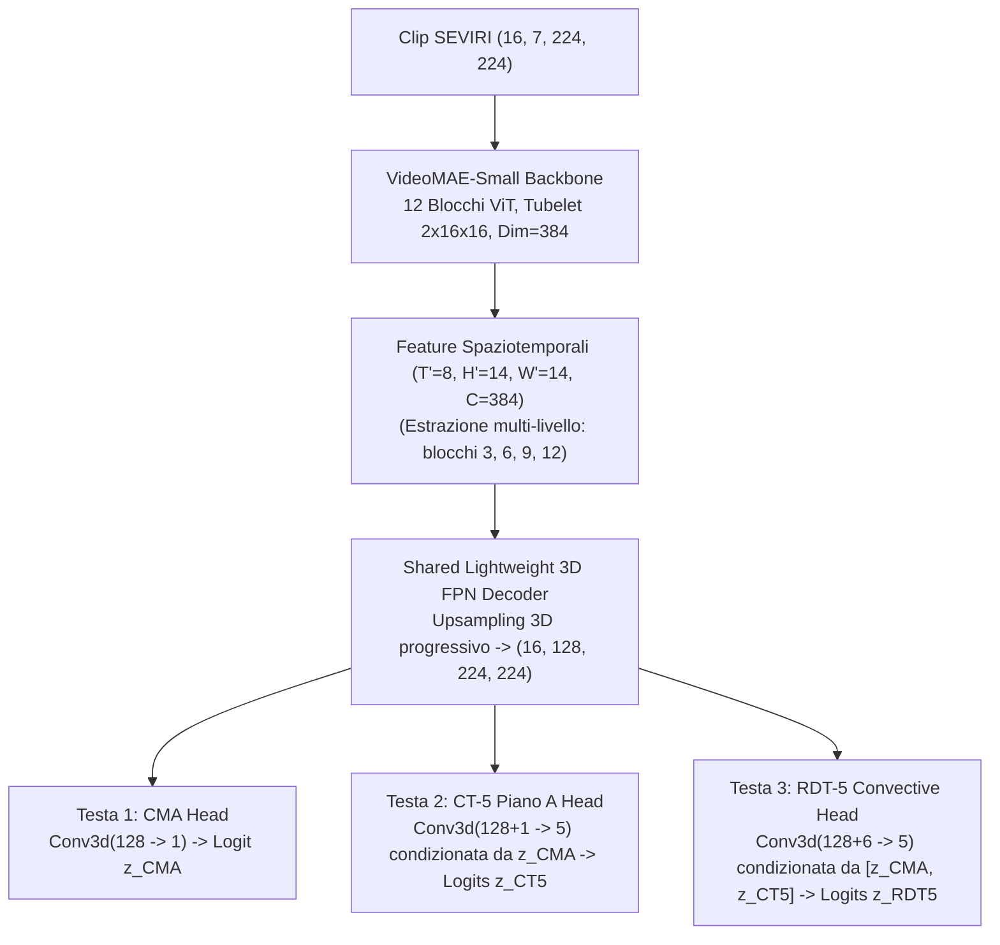
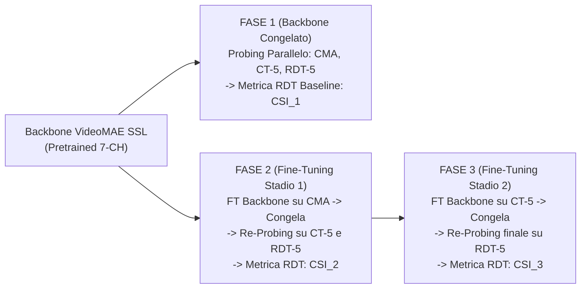

# Specifiche di Probing Multi-Task a Tre Teste e Protocollo Sequenziale (`three_heads_probing.md`)

Documento tecnico-scientifico per la costruzione del dataset di probing congiunto a 3 teste e per il protocollo di valutazione (parallelo a backbone congelato e sequenziale con curriculum fine-tuning) sul backbone **VideoMAE-Small** (7 canali SEVIRI IR in Kelvin, 16 frame a cadenza 5 minuti, risoluzione spaziale $224 \times 224$).

## Revisione esplorativa approvata il 9 novembre 2026

Per i primi esperimenti a tre teste si applicano le due modifiche seguenti ai
passi 2 e 4 della sezione 5. Le specifiche originali restano disponibili sotto
come riferimento. La configurazione eseguibile della revisione è
`configs/three_head_probe_dataset_exploratory2022.json`.

- **Accordo RDT–CT:** la frazione dei pixel convettivi RDT classificati da CT
  come nube alta opaca viene riportata come diagnostica, insieme al riferimento
  originale del 90%. Restano obbligatori almeno il 99,5% di accordo con CMA e
  meno dello 0,1% di appartenenza alle classi CT sereno/nube bassa, calcolati
  sul dominio completo prima delle esclusioni per storia temporale. Il manifest
  conserva sia l'esito del criterio originale sia l'accettazione secondo la
  revisione esplorativa. Le etichette del teacher corretto v3 restano invariate.
- **Gruppo B, nubi fredde:** si richiedono almeno il 25% di pixel CT di nube
  alta opaca o cirro e almeno l'1% di pixel RDT di nube fredda non convettiva,
  sul totale dei target validi della clip. Le clip che contengono convezione
  sono ammesse se il pixel centrale dell'ultimo frame è una nube fredda non
  convettiva RDT e appartiene a una delle due classi CT alte. Questa assegnazione
  ha priorità sul gruppo A. Il caso originario di clip completamente prive di
  convezione resta incluso. Ogni pixel conserva la propria classe: il gruppo
  definisce il campionamento della clip e il target resta una segmentazione.

Il training usa il 1–2 luglio 2022, la validation il 4 luglio e il test il
7 luglio, con 512, 192 e 192 clip rispettivamente. Le probabilità dei gruppi
A/B/C restano 50/30/20%; il peso triplo delle clip con overshooting top si
applica all'interno del solo gruppo A. Validation e test usano campionamento
uniforme delle posizioni e delle finestre temporali. Tutti i periodi sono
separati dalle date del pretraining e della sua validation. I risultati
misurano la decodificabilità di queste pseudo-label nei periodi selezionati;
la verifica meteorologica su osservazioni indipendenti resta un passo successivo.

Con il teacher corretto l'accordo CT di luglio è 87,1%, 86,9% e 84,1% nei tre
split; gli altri due criteri sono soddisfatti. Il campionamento del gruppo B
centrato su nubi fredde rende utilizzabili scene miste, frequenti nei volumi
di 16 frame e 224 × 224 pixel. La diagnostica della correzione e le definizioni
dei target sono documentate in `docs/three_head_probe_implementation.md`.

---

## 1. Obiettivo e Flusso Canonico

In conformità con [`AGENTS.md`](file:///c:/Users/Daniele.LOKI/Documents/Progetti/deep_convection/AGENTS.md), il pretraining self-supervised su SEVIRI a 7 canali e il probing downstream sono fasi separate:

```text
Archivio SEVIRI 7-CH non etichettato (WV_062, WV_073, IR_087, IR_097, IR_108, IR_120, IR_134)
    └──> Pretraining VideoMAE-Small self-supervised (Tube Masking 90%, tubelet 2x16x16, norm_pix_loss=False)
            ├──> PROTOCOLLO A (Principale — Backbone Congelato):
            │       Decoder 3D FPN leggero -> 3 Teste simultanee (CMA, CT Piano A a 5 classi, RDT a 5 classi)
            └──> PROTOCOLLO B (Ablazione di Trasferimento Gerarchico — Curriculum Sequenziale):
                    Fase 1 (3 Sonde Parallele) -> Fase 2 (FT su CMA + 2 Sonde) -> Fase 3 (FT su CT + Sonda RDT)
```

> **Esclusione del Piano B per il Cloud Type**: Come stabilito dopo la verifica visiva e radiometrica, la scomposizione del Cloud Type in due sottoteste separate (*Piano B: Quota + Spessore Ottico*) è ridondante rispetto alla classificazione consolidata. Il sistema adotta **esclusivamente il Piano A (5 classi totali: `0 = Clear Sky` + 4 macro-regimi nuvolosi)** per la seconda testa.

---

## 2. Indipendenza Algoritmica tra RDT e CT (NWC SAF Operativo vs Nostre Implementazioni Pure-IR)

Prima di usare congiuntamente `CMA`, `CT` e `RDT`, è fondamentale chiarire se `RDT` condivida o meno con `CT` il meccanismo di risoluzione delle nubi opache:

### 2.1 Versioni Operative Ufficiali NWC SAF (`GEO-CMA`, `GEO-CT`, `GEO-RDT-CW`)
- **`GEO-CMA` e `GEO-CT` operativi** (ATBD `NWC/CDOP2/GEO/MFL/SCI/ATBD/Cloud`, v2.1) classificano **pixel per pixel** la presenza, la fase e la quota barica della nube confrontando la temperatura di brillanza $T_{10.8}$ e le BTD statiche ($T_{10.8}-T_{12.0}$, $T_{8.7}-T_{10.8}$, $T_{6.2}-T_{10.8}$, $T_{13.4}-T_{10.8}$) contro i profili termodinamici verticali di un modello meteorologico numerico (NWP: $T_{\text{surf}}, T_{850}, T_{700}, T_{500}, T_{\text{tropo}}$) e un atlante statico di linea di costa/elevazione.
- **`GEO-RDT-CW` operativo** (ATBD `NWC/CDOP3/GEO/MFL/SCI/ATBD/Convection`, v2.2) **NON usa l'algoritmo di `GEO-CT` per individuare o delimitare le torri convettive**. Il motore geometrico di RDT opera sul campo continuo di temperatura `IR_108` tramite **slicing isotermico adattivo** a passo di $1\text{ K}$ (da $253\text{ K}$ fino a $203\text{ K}$), costruendo un albero morfologico di contorni chiusi (*torre vs plateau d'incudine*). Nell'operatività NWC SAF, il prodotto `GEO-CT` viene letto da `GEO-RDT-CW` **soltanto come filtro opzionale a monte (*pre-screening*)** per scartare oggetti interamente composti da nubi basse calde o cirri sottili prima della discriminazione statistica, ma la risoluzione dei contorni opachi e l'identificazione dell'updraft avvengono con un meccanismo fisico e matematico completamente diverso.

### 2.2 Nostre Implementazioni Pure-SEVIRI ([`CMA_original`](file:///c:/Users/Daniele.LOKI/Documents/Progetti/deep_convection/CMA_original), [`CT_original`](file:///c:/Users/Daniele.LOKI/Documents/Progetti/deep_convection/CT_original), [`RDT_original`](file:///c:/Users/Daniele.LOKI/Documents/Progetti/deep_convection/RDT_original) / [`src/emma_gpm/rdt/`](file:///c:/Users/Daniele.LOKI/Documents/Progetti/deep_convection/src/emma_gpm/rdt/))
Nelle nostre implementazioni Pure-IR i due rami sono **al 100% indipendenti a livello di codice, di soglie e di architettura**:
1. **[`CT_original/ct_nwcsaf/classifier.py`](file:///c:/Users/Daniele.LOKI/Documents/Progetti/deep_convection/CT_original/ct_nwcsaf/classifier.py)** risolve le nubi alte opache (**Classi 8 e 9 $\rightarrow$ Piano A Classe 3**) a livello di **singolo pixel**:
   - Stima il profilo termico superficiale e troposferico ($T_{\text{surf}}, T_{850}, T_{700}, T_{500}, T_{\text{tropo}}$) con maschera costiera geostazionaria esatta e quantili regionali sugli ultimi 60 minuti.
   - Assegna un pixel a `High Opaque` se è coperto da nube (`CMA == 1`), non appartiene al regime semitrasparente/cirro (`is_semitransparent == False` secondo lo split-window $T_{10.8}-T_{12.0}$ e il contrasto ghiaccio $T_{8.7}-T_{10.8}$) e possiede $T_{10.8} < T_{500} + 2.0\text{ K}$ ($P_{\text{top}} < 450\text{ hPa}$).
2. **[`src/emma_gpm/rdt/pure_gen_utls.py`](file:///c:/Users/Daniele.LOKI/Documents/Progetti/deep_convection/src/emma_gpm/rdt/pure_gen_utls.py)** (`PureGenUtlsTracker`) **non importa né invoca mai `CMA_original` o `CT_original`**:
   - Calcola una proxy causale $T_{\text{UTLS}}(t)$ dell'incudine/tropopausa pesando il plateau freddo tramite 6 BTD spettrali normalizzate per spessore ottico ($BTD_{\text{WV62-108}}, BTD_{\text{WV62-73}}, BTD_{\text{CO2}}, BTD_{\text{O3}}, BTD_{\text{SW}}, BTD_{\text{ICE}}$).
   - Esegue lo slicing morfologico a $1\text{ K}$ su `IR_108` sotto $T_{\text{warm}} = \min(\text{clip}(T_{\text{UTLS}}+35\text{ K}, 240, 260), 253\text{ K})$ per isolare gli oggetti-cella conexi ($\ge 3$ pixel).
   - Traccia le celle nel tempo (overlapping + cross-correlazione di fase) e calcola su 3 intervalli RSS reali (15 minuti) i tassi Lagrangiani di raffreddamento $\Delta T_{15\text{min}}$, espansione d'area e divergenza delle BTD per distinguere le celle convettive attive (`Classi 2, 3, 4`) dalle nubi fredde stratiformi (`Classe 1`).

**Conclusione fondamentale**: Poiché `CT_original` e `RDT_original` non condividono né codice né soglie, il fatto che il **`94.90%` dei pixel convettivi RDT cada esattamente dentro la classe `High Opaque` del nostro `CT` (e il `100.00%` dentro `CMA`, con appena lo `0.0127%` di falsi negativi)** rappresenta una **validazione fisica indipendente** e non una tautologia per costruzione.

---

## 3. Cosa Significa "Nidificazione Fisica" (Inclusione Spaziale Gerarchica)

Con il termine **nidificazione fisica** (*spatial nesting* o inclusione insiemistica gerarchica) intendiamo che, in ogni istante $t$ e su ogni pixel $(y,x)$ del dominio geografico $\Omega$, i fenomeni atmosferici formano **sottoinsiemi spaziali fisicamente incapsulati l'uno dentro l'altro**:

$$\Omega_{\text{OT}} \subset \Omega_{\text{RDT-Conv}} \subset \Omega_{\text{CT-HighOpaque}} \subset \Omega_{\text{CMA-Cloud}} \subset \Omega$$

Dove:
1. **$\Omega_{\text{CMA-Cloud}}$ (`Testa 1: CMA == 1`)** è l'insieme di tutti i pixel coperti da una qualsiasi nube (bassa, media, alta, opaca o semitrasparente).
2. **$\Omega_{\text{CT-HighOpaque}}$ (`Testa 2: CT Piano A == 3`)** è il sottoinsieme di $\Omega_{\text{CMA-Cloud}}$ costituito dalle sole nubi **alte e otticamente spesse** ($P_{\text{top}} < 450\text{ hPa}, \tau > 4$), che comprendono sia i cumulonembi attivi sia le vaste incudini stratiformi e i corpi frontali freddi.
3. **$\Omega_{\text{RDT-Conv}}$ (`Testa 3: RDT in {2, 3, 4}`)** è il sottoinsieme ancora più ristretto (tipicamente il $5\%\text{–}20\%$ dell'area di $\Omega_{\text{CT-HighOpaque}}$) formato dai **nuclei convettivi dinamicamente attivi** (torri in rapido raffreddamento verticale o nuclei maturi ad alta profondità relativa $D$).
4. **$\Omega_{\text{OT}}$ (`Testa 3: RDT == 4`)** è il nucleo puntiforme più interno ($1\text{–}15$ pixel al culmine dell'updraft) che perfora la tropopausa entrando nella bassa stratosfera (*Overshooting Top*).

```text
+-----------------------------------------------------------------------+
| Dominio SEVIRI Completo (Ω)                                           |
|  +-----------------------------------------------------------------+  |
|  | Testa 1: Cloud Mask (CMA == 1: Tutte le nubi)                   |  |
|  |  +-----------------------------------------------------------+  |  |
|  |  | Testa 2: CT Piano A == 3 (High Opaque Cloud, P < 450 hPa) |  |  |
|  |  |  +-----------------------------------------------------+  |  |  |
|  |  |  | Testa 3: RDT Convezione Attiva (Classi 2, 3, 4)     |  |  |  |
|  |  |  |   +---------------------------------------------+   |  |  |  |
|  |  |  |   | Overshooting Top (RDT Classe 4: Updraft OT) |   |  |  |  |
|  |  |  |   +---------------------------------------------+   |  |  |  |
|  |  |  +-----------------------------------------------------+  |  |  |
|  |  +-----------------------------------------------------------+  |  |
|  +-----------------------------------------------------------------+  |
+-----------------------------------------------------------------------+
```

Perché la nidificazione è cruciale per il nostro modello a 3 sonde?
- Se una rete neurale predice una cella convettiva (`Testa 3`) in un pixel che la `Testa 1` classifica come cielo sereno o che la `Testa 2` classifica come nube calda di strato limite, la predizione viola la termodinamica.
- Addestrando o condizionando le 3 teste secondo questa gerarchia, la `Testa 1` impara a sopprimere il fondo terrestre/marino, la `Testa 2` isola i sistemi profondi in alta troposfera e la `Testa 3` concentra tutta la capacità discriminativa temporale di VideoMAE (attenzione 3D su 16 frame) esclusivamente per separare gli updraft convettivi attivi dalle incudini stratiformi passive.

---

## 4. Definizione Esatta delle Tre Teste di Probing

### Testa 1: Cloud Mask (`CMA Pure-IR`) — Segmentazione Binaria (2 Classi)
Generata da [`CMA_original/cma_nwcsaf/detector.py`](file:///c:/Users/Daniele.LOKI/Documents/Progetti/deep_convection/CMA_original/cma_nwcsaf/detector.py) con risoluzione automatica della linea di costa geostazionaria:
- `0`: **Clear Sky** (Terra o mare liberi da nubi)
- `1`: **Cloud** (Nube rilevata: Opaque + Fractional + Semitransparent)

### Testa 2: Cloud Type (`CT Piano A`) — 5 Macro-Regimi Fisici (4 Classi Nuvolose + Clear Sky)
Generata da [`CT_original/ct_nwcsaf/classifier.py`](file:///c:/Users/Daniele.LOKI/Documents/Progetti/deep_convection/CT_original/ct_nwcsaf/classifier.py) mappando le 15 classi NWC SAF nei 5 regimi fisici consolidati:

| ID Classe (`y_ct5`) | Nome Macro-Regime | Classi NWC SAF `GEO-CT` | Significato Fisico e Ruolo Gerarchico |
| :-: | :--- | :--- | :--- |
| **`0`** | **Clear Sky** | `1, 2, 3, 4` | Superficie terrestre o marina serena (`CMA == 0`) |
| **`1`** | **Low Cloud** | `5, 6, 10` | Nubi basse calde e frazionarie di strato limite ($P_{\text{top}} > 650\text{ hPa}$) |
| **`2`** | **Mid Cloud** | `7` | Nubi medie opache ($450 \le P_{\text{top}} \le 650\text{ hPa}$) |
| **`3`** | **High Opaque** | `8, 9` | **Inviluppo dei sistemi profondi e incudini spesse** ($P_{\text{top}} < 450\text{ hPa}, \tau > 4$) |
| **`4`** | **Cirrus & Multilayer** | `11, 12, 13, 14, 15` | Nubi di ghiaccio semitrasparenti, bordi d'incudine e sistemi multistrato ($\tau < 4$) |

### Testa 3: Dinamica Convettiva (`RDT Pure-IR`) — 5 Classi del Ciclo di Vita Convettivo
Generata dal teacher causale multispettrale UTLS v0 in [`src/emma_gpm/rdt/labeler.py`](file:///c:/Users/Daniele.LOKI/Documents/Progetti/deep_convection/src/emma_gpm/rdt/labeler.py):
- `0`: **Background / Clear or Warm Cloud** (Sfondo non appartenente a sistemi freddi in quota — * Blu ardesia scuro*)
- `1`: **Cold Non-Convective Cloud** (Nube fredda passiva / incudine stratiforme non convettiva — *Grigio-blu acciaio*)
- `2`: **Convective Triggering / Growing** (Cella convettiva in innesco o sviluppo rapido: raffreddamento 15-min ed espansione d'area — *Giallo limone `#FAE014`*)
- `3`: **Convective Mature / Decaying** (Cella convettiva matura o in fase di dissipazione organizzata — *Arancione vivo `#FF8800`*)
- `4`: **Overshooting Top (OT)** (Nucleo estremo che penetra nella bassa stratosfera — *Rosso-Magenta `#EB0055`*)

*(Nota: per il piano riassuntivo da presentazione suddiviso in slide si veda [`PRESENTATION_SLIDES_PLAN.md`](file:///c:/Users/Daniele.LOKI/Documents/Progetti/deep_convection/PRESENTATION_SLIDES_PLAN.md)).*

*(Nota: in fase di valutazione metrica si riportano sia le metriche sulle 5 classi complete di `RDT`, sia la metrica binaria aggregata su `Convezione Attiva = {2, 3, 4}` contro `{0, 1}`).*

---

## 5. Procedura Dettagliata di Preparazione del Dataset di Probing a 3 Teste

Il dataset di probing deve rispettare tutti gli invarianti fisici e numerici stabiliti in [`AGENTS.md`](file:///c:/Users/Daniele.LOKI/Documents/Progetti/deep_convection/AGENTS.md). Di seguito è descritta passo-passo la pipeline operativa per costruirlo.

### Passo 1: Esecuzione Causale sul Dominio Completo (Full-Domain First)
sia `NwcSafCmaCtTracker` (`CMA + CT`) sia `PureGenUtlsTracker` (`RDT`) dipendono dal contesto spaziale su scala sinottica e dalla storia temporale:
- **Vietato eseguire i teacher direttamente sulle patch ritagliate $224 \times 224$**, perché un ritaglio locale troncherebbe i contorni chiusi delle isoterme `IR_108`, impedirebbe il tracking Lagrangiano delle celle che attraversano il bordo della clip e falserebbe i quantili regionali di $T_{\text{surf}}$ e del plateau $T_{\text{UTLS}}$.
- Pertanto, su ogni giornata continua dell'archivio Zarr SEVIRI $(H_{\text{dom}}, W_{\text{dom}}) = (763, 1762)$ a cadenza $\Delta t = 5\text{ min}$:
  1. Si esegue in streaming causale [`NwcSafCmaCtTracker.step(cube_7ch)`](file:///c:/Users/Daniele.LOKI/Documents/Progetti/deep_convection/CT_original/ct_nwcsaf/pipeline.py) producendo per ogni slot $t$ le mappe intere `cma[t]` $\in \{0, 1\}$ e `ct5[t]` $\in \{0, 1, 2, 3, 4\}$ (tramite `map_ct_to_5_regimes`).
  2. Si esegue in streaming causale [`PureGenUtlsTracker.step(cube_7ch, timestamp)`](file:///c:/Users/Daniele.LOKI/Documents/Progetti/deep_convection/src/emma_gpm/rdt/pure_gen_utls.py) producendo per ogni slot $t$ la mappa intera `rdt5[t]` $\in \{0, 1, 2, 3, 4\}$ e la maschera di qualità `quality_mask[t]`.
  3. **Warm-up causale**: I primi 3 slot di ogni sequenza continua ($15\text{ min}$, necessari per calcolare le derivate reali a 3 intervalli RSS $\Delta t = 15\text{ min}$) vengono usati solo come warm-up dei tracker e non generano target di training.

### Passo 2: Verifica di Coerenza Inter-Teacher (Gate di Qualità Automatico)
Prima di salvare le pseudo-label di un periodo, lo script di validazione ([`probe_consistency_verification/verify_ct_rdt_consistency.py`](file:///c:/Users/Daniele.LOKI/Documents/Progetti/deep_convection/probe_consistency_verification/verify_ct_rdt_consistency.py)) controlla che sul dominio completo valgano:
- $\text{Recall}(\text{RDT} \ge 2 \text{ in } \text{CMA} == 1) \ge 99.5\%$
- $\text{Recall}(\text{RDT} \ge 2 \text{ in } \text{CT5} == 3) \ge 90.0\%$
- $\text{False Exclusion}(\text{RDT} \ge 2 \text{ in } \text{CT5} \in \{0, 1\}) < 0.1\%$

### Passo 3: Estrazione delle Clip Spaziotemporali $(16, 7, 224, 224)$ e Target $(16, 224, 224)$
Per ogni finestra temporale valida di $T = 16$ frame consecutivi a passo di $5\text{ min}$ (copertura esatta di $75\text{ min}$ da $t_0$ a $t_{15}$):
1. **Controllo di integrità radiometrica e temporale**:
   - Si verifica che $\forall k \in \{0,\dots,14\}$, $t_{k+1} - t_k == 5\text{ min}$ (nessun salto temporale, nessuna interpolazione o ripetizione di frame).
   - Si verifica l'orientamento **North-Up, West-Left** dalle coordinate `lat`/`lon`.
   - Qualsiasi clip con pixel `NaN`, infiniti o canali mancanti nei 7 canali obbligatori (`WV_062, WV_073, IR_087, IR_097, IR_108, IR_120, IR_134`) viene **rifiutata integralmente**.
2. **Normalizzazione globale dell'input**:
   - I valori in Kelvin vengono normalizzati con **una sola media globale $\mu_{\text{global}}$ e una sola deviazione standard globale $\sigma_{\text{global}}$** calcolate su tutti i pixel e tutti i canali del solo *training split* (`norm_pix_loss=False`, nessuna normalizzazione per canale, clip o frame).
3. **Allineamento dei 3 Target per ogni Clip**:
   - Ogni campione del dataset di probing restituisce la tupla:
     $$\mathcal{S}_i = \Big( X_i \in \mathbb{R}^{16 \times 7 \times 224 \times 224},\; Y^{\text{CMA}}_i \in \{0,1\}^{16 \times 224 \times 224},\; Y^{\text{CT5}}_i \in \{0..4\}^{16 \times 224 \times 224},\; Y^{\text{RDT5}}_i \in \{0..4\}^{16 \times 224 \times 224},\; M^{\text{valid}}_i \in \{0,1\}^{16 \times 224 \times 224} \Big)$$
   - `M_valid` vale `1` dove l'osservazione e la storia a 15 minuti per i trend RDT sono entrambe valide, `0` altrimenti (i pixel con `M_valid == 0` ricevono `ignore_index = 255` nella loss).

### Passo 4: Campionamento Spaziale Stratificato e Split Temporale Senza Contaminazione
Poiché le celle convettive coprono solo lo $0.5\%\text{–}3\%$ del dominio SEVIRI, un campionamento puramente uniforme produrrebbe oltre l'$85\%$ di clip prive di convezione:
- **Split Temporale con Intervallo Cuscinetto (Fascia di Guardia Temporale)**: Train, Validation e Test sono separati per blocchi temporali continui (giornate o settimane distinte) lasciando un **intervallo cuscinetto inutilizzato di almeno 24 ore** tra la fine di un blocco e l'inizio del successivo. Questo intervallo vuoto garantisce che la stessa perturbazione meteorologica vista negli ultimi frame del training non ricompaia pochi minuti dopo nei primi frame della validazione o del test (evitando contaminazione dovuta alla persistenza sinottica delle nubi).
- **Stratificazione delle Clip $224 \times 224$**:
  - **Bucket A (50% dei batch — Convezione Attiva / OT)**: Clip che contengono almeno un oggetto con `RDT >= 2` (con oversampling $3\times$ per le clip contenenti `RDT == 4` Overshooting Top).
  - **Bucket B (30% dei batch — Sistemi Stratiformi Alti / Cirri / Fronti)**: Clip prive di convezione attiva ma ricche di `CT5 == 3 (High Opaque)` e `CT5 == 4 (Cirrus)` + `RDT == 1`, indispensabili come *hard negatives* affinché la rete non confonda ogni nube fredda con un temporale.
  - **Bucket C (20% dei batch — Nubi Basse, Medie e Cielo Sereno)**: Clip dominate da `CT5 in {0, 1, 2}` (coste, terra fredda notturna, strati marini) per ancorare `CMA` e `CT`.

---

## 6. Architettura del Decoder 3D FPN e Condizionamento Gerarchico delle 3 Teste



### Condizionamento Gerarchico Esplicito (Hierarchical Logit Conditioning)
Oltre a condividere il decoder 3D FPN ($128$ canali a risoluzione $16 \times 224 \times 224$):
1. La **Testa 1 (`CMA`)** produce il logit $z_{\text{CMA}} \in \mathbb{R}^{16 \times 1 \times 224 \times 224}$.
2. La **Testa 2 (`CT Piano A`)** riceve in ingresso la concatenazione $[F_{\text{FPN}}, \sigma(z_{\text{CMA}})]$ ($129$ canali) e produce i 5 logit $z_{\text{CT5}} \in \mathbb{R}^{16 \times 5 \times 224 \times 224}$.
3. La **Testa 3 (`RDT Convezione`)** riceve in ingresso $[F_{\text{FPN}}, \sigma(z_{\text{CMA}}), \text{softmax}(z_{\text{CT5}})]$ ($134$ canali) e produce i 5 logit $z_{\text{RDT5}} \in \mathbb{R}^{16 \times 5 \times 224 \times 224}$.

### Funzione di Loss Multi-Task con Vincolo Fisico di Nidificazione
$$\mathcal{L}_{\text{total}} = \lambda_{\text{CMA}} \mathcal{L}_{\text{CMA}} + \lambda_{\text{CT5}} \mathcal{L}_{\text{CT5}} + \lambda_{\text{RDT5}} \mathcal{L}_{\text{RDT5}} + \lambda_{\text{nest}} \mathcal{L}_{\text{nesting}}$$
dove:
- $\mathcal{L}_{\text{CMA}} = \text{BCE}(z_{\text{CMA}}, Y^{\text{CMA}}) + \text{Dice}(z_{\text{CMA}}, Y^{\text{CMA}})$
- $\mathcal{L}_{\text{CT5}} = \text{FocalLoss}_{\gamma=2}(z_{\text{CT5}}, Y^{\text{CT5}}) + \text{MultiClassDice}(z_{\text{CT5}}, Y^{\text{CT5}})$
- $\mathcal{L}_{\text{RDT5}} = \text{WeightedFocalLoss}_{\gamma=2}(z_{\text{RDT5}}, Y^{\text{RDT5}}) + \text{GeneralizedDice}(z_{\text{RDT5}}, Y^{\text{RDT5}})$
- **$\mathcal{L}_{\text{nesting}}$ (Penalità di consistenza gerarchica)**:
  $$\mathcal{L}_{\text{nesting}} = \mathbb{E}_{t,y,x}\Big[ \max\big(0,\; P_{\text{RDT}}(\text{Conv}) - P_{\text{CT5}}(\text{HighOpaque})\big)^2 + \max\big(0,\; P_{\text{CT5}}(\text{Cloud}) - P_{\text{CMA}}(\text{Cloud})\big)^2 \Big]$$
  Questa penalità differenziabile insegna alla rete che la probabilità di convezione attiva non può mai superare la probabilità che il pixel appartenga a una nube alta opaca, e la probabilità di nube in `CT5` non può superare quella di `CMA`.

---

## 7. Protocollo di Verifica in Parallelo vs Protocollo Sequenziale (Curriculum Fine-Tuning)

Per rispondere rigorosamente sia ai requisiti di [`AGENTS.md`](file:///c:/Users/Daniele.LOKI/Documents/Progetti/deep_convection/AGENTS.md) (che impongono il **backbone congelato** per la prova scientifica principale del pretraining VideoMAE) sia alla verifica dell'utilità di un **adattamento progressivo (curriculum fine-tuning)** dalla maschera nuvolosa fino alla convezione, il protocollo sperimentale è strutturato in **due suite complementari**.



### Fase 1: Probing a Backbone Congelato (Benchmark Scientifico Canonico)
1. Si mantiene il backbone VideoMAE-Small **completamente congelato** ($\nabla_{\theta_{\text{enc}}} = 0$).
2. Si eseguono:
   - **Run 1A (Probe Singoli Indipendenti)**: 3 decoder 3D FPN addestrati separatamente su `CMA`, `CT-5` e `RDT-5`.
   - **Run 1B (Probe Congiunto a 3 Teste)**: Un unico decoder 3D FPN con le 3 teste simultanee e condizionamento gerarchico ($\mathcal{L}_{\text{total}}$).
3. Si registrano le metriche di riferimento sul test set per la convezione (`CSI`, `F1` per classe RDT, `Brier Score`, `IoU`): questo misura quanto il puro pretraining generativo MAE a 7 canali renda decodificabili le celle convettive senza modificare l'encoder.

### Fase 2: Fine-Tuning del Backbone su `CMA` $\rightarrow$ Re-Probing su `CT-5` e `RDT-5`
1. Partendo dal checkpoint VideoMAE SSL della Fase 1, si sblocca il backbone e lo si addestra sul task **Cloud Mask (`CMA`)**.
2. Terminato l'addestramento su `CMA`, **si congela nuovamente il backbone** ($\theta_{\text{enc}}^{\text{CMA}}$).
3. Con il backbone $\theta_{\text{enc}}^{\text{CMA}}$ congelato, si re-inizializzano da zero i decoder di probing e si ri-addestrano le **2 sonde rimanenti** (`CT-5 Piano A` e `RDT-5 Convezione`).
4. **Domanda scientifica verificata**: Adattare le feature dell'encoder a separare con estrema nitidezza le nubi dalla superficie terrestre/marina migliora la successiva classificazione dei regimi nuvolosi (`CT-5`) e delle celle convettive (`RDT-5`), rispetto al backbone puramente self-supervised?

### Fase 3: Fine-Tuning del Backbone su `CT-5` $\rightarrow$ Re-Probing Finale su `RDT-5`
1. Partendo dal backbone $\theta_{\text{enc}}^{\text{CMA}}$ della Fase 2, si sblocca nuovamente il backbone e lo si affina sul task a 5 regimi **Cloud Type (`CT-5 Piano A`)**.
2. Terminato il fine-tuning su `CT-5`, **si congela il nuovo backbone** ($\theta_{\text{enc}}^{\text{CMA}\rightarrow\text{CT5}}$).
3. Con il backbone $\theta_{\text{enc}}^{\text{CMA}\rightarrow\text{CT5}}$ congelato, si re-inizializza da zero e si addestra **l'ultima sonda sulla convezione (`RDT-5`)**.
4. Si confronta direttamente la prestazione finale sulla convezione ($\text{CSI}_3$) con quella della Fase 2 ($\text{CSI}_2$) e della Fase 1 ($\text{CSI}_1$).

### Valutazione Critica: È Utile il Protocollo Sequenziale? Qual è il Rischio Fisico e Come Mitigarlo?
Il test sequenziale (`SSL -> CMA -> CT-5 -> RDT-5`) è **molto utile come esperimento diagnostico**, perché misura se l'apprendimento di un curriculum atmosferico statico (*presenza nube $\rightarrow$ quota/spessore nube*) faciliti il riconoscimento dei temporali. Tuttavia, esiste un **importante rischio fisico da tenere sotto controllo**:
- **Il rischio del *Catastrophic Forgetting Temporale***:
  - `CMA` (nube vs sereno) e `CT-5` (quota e spessore ottico) sono proprietà **quasi interamente istantanee/radiometriche**: un modello può risolverle al $95\%$ guardando anche un singolo frame $t$, senza usare le correlazioni temporali tra frame consecutivi.
  - Al contrario, `RDT-5` (distinguere una torre convettiva in esplosione da una vecchia incudine fredda) dipende crucialmente dalla **derivata temporale sui 16 frame** ($\Delta T_{10.8}/\Delta t$, espansione dell'area, onde di gravità nel vapore acqueo).
  - Se nelle Fasi 2 e 3 si esegue un *full fine-tuning* aggressivo di tutti i 12 blocchi di VideoMAE solo su `CMA` e `CT-5`, i pesi di self-attention spaziotemporale rischiano di collassare su filtri puramente spaziali/spettrali, **dimenticando le feature di movimento e raffreddamento temporale** apprese durante il pretraining MAE ($\text{CSI}_3 < \text{CSI}_1$).
- **Come rendere rigorosa e vincente la verifica sequenziale (2 varianti a confronto)**:
  1. **Variante Sequenziale Pura (Unfreezing selettivo + Layer-wise LR Decay)**: Nelle Fasi 2 e 3 si sbloccano solo gli ultimi 4 blocchi Transformer (blocchi 9–12) o si usa un learning rate sul backbone $100\times$ inferiore a quello della testa ($\eta_{\text{enc}} = 10^{-5}$, $\eta_{\text{head}} = 10^{-3}$) con regolarizzazione L2 verso i pesi SSL iniziali ($\|\theta_{\text{enc}} - \theta_{\text{SSL}}\|_2^2$).
  2. **Variante Sequenziale Cumulativa (Anti-Forgetting)**: Quando nella Fase 2 si fa fine-tuning su `CMA`, si mantiene attivo un termine ausiliario di ricostruzione MAE; quando nella Fase 3 si fa fine-tuning su `CT-5`, si mantiene attiva anche la testa `CMA`. In questo modo si misura sia se il fine-tuning ingenuo soffre di forgetting temporale, sia se il curriculum regolarizzato migliora la sonda `RDT-5` finale.

---

## 8. Tabella Riassuntiva della Matrice Sperimentale

| ID Esperimento | Stato Backbone VideoMAE | Teste Attive in Probing | Scopo Scientifico |
| :--- | :--- | :--- | :--- |
| **`E0-Rand`** | Casuale (Congelato) | `CMA + CT-5 + RDT-5` | Limite inferiore (architettura 3D FPN senza rappresentazione appresa) |
| **`E0-RGB`** | Pretrained RGB adattato 7-CH (Congelato) | `CMA + CT-5 + RDT-5` | Controllo di trasferimento da video naturali |
| **`E1-Single`** | **Pretrained SEVIRI SSL (Congelato)** | Solo `RDT-5` | Baseline canonica di probing singolo RDT ([`AGENTS.md`](file:///c:/Users/Daniele.LOKI/Documents/Progetti/deep_convection/AGENTS.md)) |
| **`E1-Joint3`** | **Pretrained SEVIRI SSL (Congelato)** | **`CMA + CT-5 + RDT-5` (Parallelo)** | **Verifica del beneficio del probing multi-task gerarchico a 3 teste** |
| **`E2-Seq-CMA`** | SSL $\xrightarrow{\text{FT su CMA}}$ Congelato | `CT-5` e `RDT-5` | Misura l'effetto del fine-tuning intermedio sulla sola Cloud Mask |
| **`E3-Seq-CT5`** | SSL $\xrightarrow{\text{FT CMA}}$ $\xrightarrow{\text{FT CT-5}}$ Congelato | Solo `RDT-5` | **Misura l'effetto dell'intero curriculum sequenziale sulla convezione** |
| **`E4-JointFT`** | SSL $\xrightarrow{\text{FT congiunto 3 teste}}$ | `CMA + CT-5 + RDT-5` | Limite superiore operativo (adattamento end-to-end simultaneo) |
